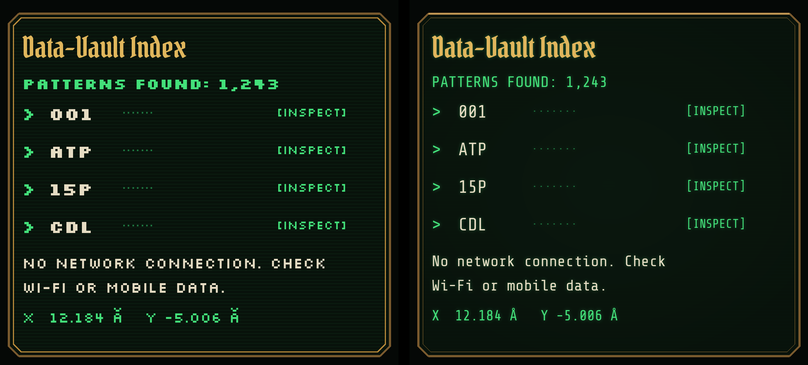

# 08c · Diseño v2 «Cogitador»: revisión del kit y su aplicación

> **Estado:** aplicado. La lógica nueva (pantalla de arranque, textos del catálogo, títulos y etiquetas de error) tiene pruebas: **239 pruebas propias**, **17 mutantes** de la lógica nueva muertos (3 de ellos tras **reforzar** las pruebas). El código de interfaz pasa el comprobador de tipos contra **declaraciones escritas a mano** de la API. **No compilado con las bibliotecas reales ni visto en el móvil**: sección 11. Sustituye al diseño v1 (documento [`08b`](08b-diseno-aplicado.md), que se conserva como historia).

## Índice

1. [De dónde viene la v2](#1-de-dónde-viene-la-v2)
2. [Revisión del kit](#2-revisión-del-kit)
3. [El arte: limpieza del halo](#3-el-arte-limpieza-del-halo)
4. [Marcos: dibujados en código, no el 9-patch](#4-marcos-dibujados-en-código-no-el-9-patch)
5. [Iconos: el conversor aprende `transform`](#5-iconos-el-conversor-aprende-transform)
6. [Fuentes, paleta y contraste](#6-fuentes-paleta-y-contraste)
7. [La pantalla de arranque: el nuevo «launch screen»](#7-la-pantalla-de-arranque-el-nuevo-launch-screen)
8. [Componentes](#8-componentes)
9. [Pantallas](#9-pantallas)
10. [Lógica pura nueva, pruebas y mutación](#10-lógica-pura-nueva-pruebas-y-mutación)
11. [Cómo probarlo en el móvil](#11-cómo-probarlo-en-el-móvil)
12. [Qué está verificado y qué no](#12-qué-está-verificado-y-qué-no)
13. [Desvíos conscientes respecto al kit](#13-desvíos-conscientes-respecto-al-kit)
14. [Alternativas](#14-alternativas)
15. [Decisiones](#15-decisiones)
16. [Qué recordar](#16-qué-recordar)
17. [Corrección: «demasiado pixelado»](#17-corrección-demasiado-pixelado)

---

## 1. De dónde viene la v2

La v1 («Culto de la Máquina» sobrio, documento 08b) se **rechazó en el móvil**: no parecía Warhammer 40k. El documento 08a, sección 12, explica por qué (el brief v1 prohibía los símbolos, el arte de mapa de bits y la densidad) y contiene el **prompt v2**. Con él, el generador devolvió el **kit v2** (91 ficheros): consolas CRT verdes, marcos de bronce, calaveras, servidor, servo-cráneo, tecnosacerdote. Fuentes elegidas por el equipo: **Pirata One** (títulos) y **Silkscreen** (todo lo demás); Silkscreen se **sustituyó** después por **Share Tech Mono** (sección 17).

---

## 2. Revisión del kit

| Pieza | Contenido | Calidad / qué se hizo |
|-------|-----------|----------------------|
| 25 pantallas PNG 1080×2400 | Arranque, acceso, catálogo (4 estados), carga, 5 errores, molécula (3 estados), compartir (4 estados), componentes | **Muy buenas**: reconocibles. Las previsualizaciones **no usan las fuentes reales** (lo dice el kit) |
| 8 ilustraciones WebP | Calavera-engranaje, archivo 404, antena rota, pizarra corrupta, reloj de arena, servidor, servo-cráneo, tecnosacerdote | **Bonitas pero sucias**: halo claro opaco, restos de fondo, un fragmento ajeno (sección 3). **Limpiadas** |
| 31 SVG | Icono adaptable (capas), emblema, 14 iconos, 5 iconos de error, soportes, divisores, sello de cera | Usan `transform` y círculos sin `cx/cy`: el conversor **se amplió** (sección 5) |
| Marco 9-patch | `bronze_bezel.9.png` 328×328 | Guías válidas, pero **pixelado** y con esquinas de 140 px: **no se usa** (sección 4) |
| 3 texturas 128 px | CRT, hierro, pergamino | CRT para los paneles, hierro para el fondo; **pergamino descartado** (ninguna pantalla lo usa) |
| `SwiftyTheme.kt`, `SwiftyWidgets.kt` | Código de ejemplo (paquete `com.example`) | Se tomaron **los valores**; los componentes se escribieron de nuevo sobre nuestros tipos |
| Especificación | Paleta, roles M3, escala tipográfica, movimiento, reglas | Seguida, salvo los desvíos de la sección 13 |

---

## 3. El arte: limpieza del halo

**El problema, medido.** Pintadas sobre magenta (para ver la transparencia), las 8 ilustraciones mostraban: (a) un **halo gris claro** alrededor de cada objeto; (b) **restos de fondo** detrás del servo-cráneo y del tecnosacerdote; (c) un **trozo de otra ilustración** en el borde derecho del tecnosacerdote (el generador las recortó de una hoja común). Sobre la consola verde-negra, el halo se vería como **suciedad luminosa**.

**Primer intento (fallido):** oscurecer los píxeles **semitransparentes**. No cambió nada: **el halo era opaco**. Se midieron sus colores: gris **neutro** (saturación < 0,10, luminosidad 0,5–0,95), mientras que el hueso de las calaveras es **cálido** (saturación ≥ 0,35, percentil 10, medido en tres ilustraciones).

**El algoritmo final** (`art_clean/clean.py`, fuera del repositorio):

1. **Relleno por inundación** (*flood fill*) desde la zona transparente y desde el borde de la imagen, **solo** a través de píxeles «tipo halo»: gris neutro (saturación < 0,13 y luminosidad > 0,40) **o** semitransparente claro poco saturado (alfa < 235, luminosidad > 0,45, saturación < 0,30; el borde medido tenía saturación ~0,17). La inundación **se detiene** en los contornos oscuros y en los colores cálidos de los objetos: el hueso no se toca.
2. **Componentes conexos:** se eliminan los fragmentos **pequeños que tocan el borde** (el trozo ajeno) y las motas sueltas; las esquirlas de la pizarra rota, que no tocan el borde, **se conservan**.
3. **Borde suave:** los 2 píxeles junto al nuevo contorno se oscurecen y se hacen semitransparentes (sin recorte dentado).

**Resultado de la primera versión:** halos y fondos fuera, el fragmento fuera, el hueso intacto. **Visto en el móvil, no bastaba:** en la pantalla de arranque (calavera a 200 dp) se veía una **orla blanca dentada** a lo largo de los dientes del engranaje, y quedaban **bolsas** de fondo claro encerradas entre piezas (entre cables, tras la aureola del tecnosacerdote, en los agujeros de la antena). Dos pasos más:

4. **Bolsas encerradas:** regiones muy claras y neutras (luminosidad > 0,62, saturación < 0,10) de **25 px o más**, estén donde estén, son fondo: ningún objeto pintado aquí es tan blanco y tan gris en una superficie así. La inundación desde fuera no llegaba a ellas.
5. **Franja del borde:** a menos de **6 px** del fondo, se quita lo claro y poco saturado (luminosidad > 0,55, saturación < 0,35), **en varias rondas** (al quitar una capa aparece la siguiente). Es la orla de los dientes: píxeles un poco más saturados u opacos que el halo, que la regla 1 no cogía. El bronce (saturación ≥ 0,5) y el pergamino de las cintas (~0,45) quedan fuera del umbral.

6. **Segunda vuelta (21-11-2026, servidor y tecnosacerdote, vistos en grande en el login):** quedaban manchas claras con un **tinte rosado** (el «velo» del generador: R − B hasta ~36) que las reglas 4 y 5 no cogían (exigían gris casi puro). Regla nueva (`tools/art/clean_pockets.py`): claro (luminosidad > 0,55), poco saturado (< 0,20) y **no cálido** (R − B < 40), y además **o bien unido al fondo transparente** (crecimiento de región desde el alfa 0) **o bien una bolsa encerrada de 20 px o más**. Lo que protege el dibujo es la **calidez**: pergamino, hueso, piel y cera de vela tienen R − B > 45. Resultado: 986 píxeles fuera en el servidor y 2919 en el tecnosacerdote (dentro de la aureola, junto al báculo, entre los tubos); las velas pierden **27 píxeles** de borde (el velo pegado a su contorno), el pergamino y el hueso ninguno. Se guarda **sin pérdida** (WebP *lossless*): la compresión con pérdida volvería a ensuciar los bordes.

**Resultado final:** la orla y las bolsas fuera; la parabólica de la antena intacta (sus grietas claras son textura del dibujo, no fondo). Peso total: **~280 KB** para las 8.

**Dónde viven:** `res/drawable-nodpi/art_*.webp`. **`nodpi`** = «no escalar según la densidad de la pantalla»: el tamaño lo decide el código (`ArtImage(size = 140.dp)`). En `drawable/` normal, Android trataría 424 px como si fueran para `mdpi` y en el A33 (≈ 3×) los **ampliaría tres veces** antes de dibujarlos.

**Límite conocido:** las ilustraciones miden ~424 px. A 140–200 dp en una pantalla 3× (420–600 px) se **amplían** ligeramente: algo blandas. Para nitidez total habría que pedir al generador versiones de 800 px.

---

## 4. Marcos: dibujados en código, no el 9-patch

**Qué es un 9-patch:** un PNG con una línea de 1 px de guías negras en los bordes que dice qué franjas **estiran** y cuáles no (las esquinas no estiran): sirve para marcos de cualquier tamaño. Se comprobaron las guías del kit (estirado 140–185 px, relleno 44–283 px): **válidas**.

**Por qué no se usa:**
- Las esquinas fijas miden **140 px**: en `drawable-xxhdpi` serían ~47 dp por esquina; en `drawable/` normal, **140 dp**. Demasiado para paneles pequeños.
- Es **pixel-art plano** a 328 px: en pantallas 3× se ve tosco.
- No admite la **etiqueta** («AUSPEX QUERY») sobre el borde.
- El propio kit recomienda dibujar los paneles en código cuando hay muchos tamaños.

**Lo hecho:** `cogitatorFrame`, un dibujo en `drawBehind` con **la misma estética** (borde exterior de bronce, línea interior de latón, remaches en las esquinas, esquinas biseladas) y **nítido a cualquier densidad**:

```kotlin
// SwiftyComponents.kt · líneas 105–151
105  /** Light from above on the bronze: a highlight at the top, the plain bronze, a shadow at the bottom. */
106  private val MetalHighlight = Color(0xFFD6AA60)
107  private val MetalShadow = Color(0xFF4A361B)
108
109  /**
110   * The frame of a cogitator panel (refined against the "8-bit" look, document 08c section 17):
111   * - the glass: fill, the CRT texture, and a soft radial GLOW in the middle (a lit tube is brighter at the centre);
112   * - very faint scanlines (5 %: felt, not seen);
113   * - a bronze edge painted with a vertical GRADIENT (lit from above) instead of one flat colour, and a thin inner line;
114   * - rivets with a small highlight.
115   * Smooth gradients and soft light are what separate "aged metal and glass" from flat 8-bit blocks.
116   */
117  private fun DrawScope.cogitatorFrame(cut: Dp, fill: Color, texture: ShaderBrush?, scanlines: Boolean, accent: Color) {
118      val c = cut.toPx()
119      val outer = chamfer(size.width, size.height, c)
120      drawPath(outer, fill)
121      if (texture != null) drawPath(outer, texture, alpha = 0.55f)
122      drawPath(
123          outer,
124          Brush.radialGradient(
125              colors = listOf(SwiftyColors.Phosphor.copy(alpha = 0.07f), Color.Transparent),
126              center = Offset(size.width / 2, size.height / 2),
127              radius = maxOf(size.width, size.height) * 0.7f,
128          ),
129      )
130      if (scanlines) {
131          // CRT scanlines: a 1 px line every 3 dp, barely visible. ONLY inside panels, never over the 3D scene.
132          val step = 3.dp.toPx()
133          var y = c * 0.5f
134          while (y < size.height - c * 0.5f) {
135              drawLine(SwiftyColors.PhosphorDim.copy(alpha = 0.05f), Offset(c * 0.3f, y), Offset(size.width - c * 0.3f, y), strokeWidth = 1f)
136              y += step
137          }
138      }
139      drawPath(
140          outer,
141          Brush.verticalGradient(listOf(MetalHighlight, SwiftyColors.Bronze, MetalShadow)),
142          style = Stroke(width = 2.5.dp.toPx()),
143      )
144      drawPath(chamfer(size.width, size.height, c, inset = 4.dp.toPx()), accent.copy(alpha = 0.6f), style = Stroke(width = 1.dp.toPx()))
145      val r = 2.5.dp.toPx()
146      val d = 8.dp.toPx() + c * 0.3f
147      for ((x, y) in listOf(d to d, size.width - d to d, d to size.height - d, size.width - d to size.height - d)) {
148          drawCircle(SwiftyColors.Bronze, radius = r, center = Offset(x, y))
149          drawCircle(MetalHighlight, radius = r * 0.45f, center = Offset(x - r * 0.3f, y - r * 0.3f))
150      }
151  }
```

- **`chamfer(...)`** construye el rectángulo de esquinas cortadas a 45° como un `Path` de 8 lados.
- **Relleno** con el color del cristal y, encima, la **textura CRT** del kit al 55 % (un `ShaderBrush` que repite el azulejo de 128 px) y un **resplandor radial** verde muy tenue en el centro (un tubo encendido brilla más en el centro).
- **Líneas de barrido** (*scanlines*): 1 px cada 3 dp, verde al **5 %** (se intuyen, no se ven). **Solo dentro de paneles**, nunca sobre la escena 3D (regla del kit y del documento 08a).
- **Bronce con degradado vertical** (brillo arriba, sombra abajo: «luz desde arriba») de 2,5 dp fuera y una línea interior fina; **remaches** de bronce con un punto de brillo.
- *(Versión refinada en la sección 17: la primera usaba colores planos y barrido al 10 %.)*

---

## 5. Iconos: el conversor aprende `transform`

El conversor SVG → VectorDrawable del documento 08b **falló con error** (como debía) en 3 ficheros: el emblema calavera-engranaje está dibujado como **un diente repetido 10 veces con `rotate(36·k)`** dentro de `translate(54 54) scale(0.88)`.

**Lo añadido:**
- **`transform` → grupos anidados.** VectorDrawable tiene `<group android:translateX/Y, scaleX/Y, rotation, pivotX/Y>`. SVG aplica una lista `translate(…) scale(…)` **de derecha a izquierda**; un grupo anidado dentro de otro también compone «el de dentro primero». Por eso **cada función se convierte en un grupo** (el primero de la lista es el más exterior) y el orden queda **exactamente** como en SVG. `matrix()` y `skew` siguen dando error.
- **Círculos sin `cx/cy`** (valor por defecto **0** en SVG; el generador dibuja círculos alrededor del origen de un grupo trasladado) y **elipses**.

**La verificación, con una sorpresa.** Dibujado el original y el «aplanado» con `rsvg-convert`, 10 de 31 ficheros diferían en **2–18 píxeles**. Investigación:
1. Hipótesis: las uniones `bevel` de nuestro círculo de dos arcos dejan una muesca. Se forzó unión redonda en círculos con trazo (invisible en una unión tangente). **No cambió nada.**
2. Conclusión: `rsvg` dibuja el primitivo `<circle>` y el arco `A` con **aproximaciones Bézier distintas**: diferencias de antialiasing en el borde, no de forma.
3. **Prueba con control negativo:** comparando tras un desenfoque de 2 px (que borra el ruido de antialiasing pero no un error de forma), la peor diferencia de los 31 es **10/255**; una conversión **deliberadamente errónea** (radio desviado 0,5 unidades) da **182/255**. La métrica distingue: **la geometría es correcta**.
4. **Regresión:** los 18 iconos de la v1 se reconvirtieron con el conversor nuevo: **0 píxeles** distintos.

**El icono de la app:** fondo abismo, calavera con óptica verde en un engranaje dorado; **32,5 dp** del centro como máximo (zona segura 33). PNG para Android 7 regenerados.

**Recursos no usados todavía** (reservados): `ic_fingerprint` y `art_tech_priest` (pantalla de acceso, etapa C), divisores, sello de cera, soportes sueltos, iconos de error vectoriales (las ilustraciones los sustituyen). Pesan unos cientos de bytes cada uno; *lint* avisa (aviso, no error).

---

## 6. Fuentes, paleta y contraste

**Fuentes** (`res/font`, licencias en `assets/licenses/fonts`): `pirata_one_regular.ttf` (**nombre reservado «Pirata»** → sin modificar) y `share_tech_mono_regular.ttf` (nombre reservado «Share» → sin modificar). **Silkscreen se probó y se retiró** (sección 17). Los negativos van con `-` ASCII (`AtomText`, con prueba).

**Contraste, recalculado** (no copiado del informe del kit), sobre el cristal `console #08120B`:

| Color | Uso | Contraste | Texto normal |
|-------|-----|----------:|:--:|
| phosphor `#43E07A` | texto principal de consola | 11,06 | sí |
| bone `#E6DCC3` | texto claro | 13,97 | sí |
| gold `#E0B65C` | títulos góticos | 10,00 | sí |
| brass `#B8893A` | etiquetas | 6,06 | sí |
| ash `#ADAD9B` | secundario | 8,38 | sí |
| optic red `#FF3B2F` | errores | 5,37 | **sí** (el kit lo prohibía como texto; los números dicen que pasa) |
| disabled `#7B796C` | controles desactivados | 4,35 | no (WCAG **exime** los controles desactivados) |
| phosphor dim `#1F7A42` | barrido, separadores | 3,56 | **no**: solo decoración |
| bronze `#7A5A2E` | bordes | 3,02 | **no**: solo bordes |
| bone sobre **mars red** | botón principal | 6,64 | sí |

---

## 7. La pantalla de arranque: el nuevo «launch screen»

**Cambio de decisión (D32 sustituye a D25).** Antes, la *splash* del sistema se **retenía** 1500 ms (documento 07b). Con la v2 hay una **pantalla de arranque propia** (el cogitador «despertando»), que es un *launch screen* mucho más rico; retener **además** la del sistema daría **3 s** de espera. Ahora:

- La *splash* del sistema solo enseña el emblema **el tiempo que Android necesite** (`installSplashScreen()` sin condición; `SplashHold` y sus pruebas se **borraron**). *(Después, documento 08d, 12.4: ni siquiera el emblema; la* splash *del sistema es **invisible**: color abismo e icono vacío.)*
- La **pantalla de arranque** (`BootScreen`) dura **4200 ms** si nadie la toca (primero eran 1600; el equipo pidió el doble, 3200, y después un segundo más): dos fases elegidas por el equipo: **65 %** (2730 ms) en que las líneas de consola aparecen una a una (cada 546 ms) y se llena la barra `[##]`, y **35 %** (1470 ms) en que todo está cargado y **«> DONE» parpadea** (encendido/apagado cada 245 ms: tres parpadeos exactos). El emblema completo v3 (documento 08d).
- **Un toque la salta**, pero **nunca antes de 1 s** (`MIN_VISIBLE_MILLIS`): un toque más temprano **se recuerda** y surte efecto al llegar al segundo. Así el evaluador ve siempre el segundo que exige la hoja, aunque toque la pantalla nada más abrir. El toque **no tiene aviso en pantalla** (el equipo prefirió «DONE» a «TAP TO CONTINUE»). El toque se recoge en toda la pantalla con `clickable(indication = null)`: sin onda (no es un botón), pero TalkBack anuncia la acción («Skip the boot sequence»).
- Se muestra **una vez por arranque**: `rememberSaveable { booted }` en `SwiftyApp` (girar el móvil no la repite; un arranque nuevo sí).

La regla del tiempo es **pura** (`BootSequence`):

```kotlin
// BootSequence.kt · líneas 48–53
48  fun visibleLines(elapsedMillis: Long, total: Int, reduceMotion: Boolean = false): Int {
49      if (reduceMotion) return total
50      if (elapsedMillis < 0 || total <= 0) return total.coerceAtMost(1)
51      val every = LINES_PHASE_MILLIS / total
52      return (1 + (elapsedMillis / every).toInt()).coerceAtMost(total)
53  }
```

- La primera fase se divide en tantas partes iguales como líneas (5 → una cada 546 ms, la quinta a 2184 ms); nunca más de las que hay; «DONE» se enciende y apaga con el **mismo reloj** (`doneVisible`, probado), no con una animación aparte; con **movimiento reducido**, todas a la vez (pero la pantalla dura lo mismo: la hoja exige el segundo).
- **Reloj hacia atrás:** se protege. La prueba usa **−1000 ms** y no −50: con −50, la división entera ya da 0 y **ocultaría** la falta de la protección (lo descubrió un mutante superviviente; sección 10).

Y el bucle que la conduce:

```kotlin
// BootScreen.kt · líneas 54–61
54  LaunchedEffect(Unit) {
55      val start = SystemClock.uptimeMillis()
56      while (!BootSequence.isDone(elapsed, skipRequested)) {
57          withFrameMillis { }
58          elapsed = SystemClock.uptimeMillis() - start
59      }
60      finish()
61  }
```

- El bucle termina con `isDone(elapsed, skipRequested)`: por tiempo, **o** por toque si ya pasó el segundo mínimo (`canSkip`).
- **`withFrameMillis { }`** espera al **siguiente fotograma** (no es un bucle activo que queme CPU); se lee el reloj una vez por fotograma.
- **`SystemClock.uptimeMillis()`** es monótono: la pantalla **siempre termina**.
- `rememberUpdatedState(onFinished)`: el efecto se lanza una vez y llama a la **última** versión de la lambda.

---

## 8. Componentes

Todos en `ui/SwiftyComponents.kt`:

| Componente | Qué es |
|------------|--------|
| `CogitatorPanel(label, accent, fill, scanlines, fillHeight)` | El panel: marco dibujado + etiqueta opcional en el borde superior. Construido sobre una `Surface` **transparente**: **bloquea los toques** (tocar una tarjeta sobre la escena no gira la molécula). `fillHeight` deja que un hijo use `weight(1f)` |
| `TabLabel` | La placa de bronce con texto de consola sobre el borde |
| `CogitatorBackground` | Fondo abismo + textura de hierro + **raíles laterales** con remaches |
| `HeaderPanel`, `StatusFooter`, `TitlePlate` | Cabecera «COGITATOR // MK.VII», pie «NOOSPHERE LINK // STABLE», placa del título gótico |
| `CornerBrackets` | Soportes de mira en las 4 esquinas del visor; **no dibuja nada en el centro** y no captura toques |
| `PrimaryButton`, `SecondaryButton` | Rojo marciano con borde de oro / cristal con borde de latón y texto fósforo; ≥ 52 dp |
| `ConsoleKey` | Tecla cuadrada de 52 dp («H», «SHR»): encendida = borde y texto fósforo; estado **anunciado** a TalkBack |
| `BackKey` | «<» dorado, 48 dp |
| `ArtImage`, `BobbingArt` | Ilustración; la variante **flota ±3 dp cada 1,4 s** (solo traslación en `graphicsLayer`: no redibuja la imagen) |
| `BlinkingCursor` | «_» que parpadea cada 0,7 s |
| `rememberReduceMotion()` | Lee la escala de animaciones del sistema: a 0, todo lo decorativo se para |

```kotlin
// SwiftyComponents.kt · líneas 375–408
375  @Composable
376  fun ConsoleKey(
377      text: String,
378      onClick: () -> Unit,
379      contentDescription: String,
380      modifier: Modifier = Modifier,
381      active: Boolean = false,
382      enabled: Boolean = true,
383      stateDescription: String? = null,
384  ) {
385      val ink = when {
386          !enabled -> SwiftyColors.Disabled
387          active -> SwiftyColors.Phosphor
388          else -> SwiftyColors.Gold
389      }
390      Surface(
391          onClick = onClick,
392          enabled = enabled,
393          modifier = modifier
394              .sizeIn(minWidth = 52.dp, minHeight = 52.dp)
395              .semantics {
396                  this.contentDescription = contentDescription
397                  if (stateDescription != null) this.stateDescription = stateDescription
398              },
399          shape = CutCornerShape(6.dp),
400          color = SwiftyColors.Console,
401          contentColor = ink,
402          border = BorderStroke(if (active) 2.dp else 1.5.dp, if (active) SwiftyColors.Phosphor else SwiftyColors.Brass),
403      ) {
404          Box(contentAlignment = Alignment.Center, modifier = Modifier.padding(horizontal = 10.dp)) {
405              Text(text, style = if (active) SwiftyDataText.large.glowing(ink) else SwiftyDataText.large, color = ink)
406          }
407      }
408  }
```

---

## 9. Pantallas

- **Arranque** (`BootScreen`): sección 7.
- **Data-Vault Index** (`LigandListScreen`): cabecera; placa «Data-Vault Index» + «// BINHARIC PATTERN REGISTRY //»; panel «ARCHIVE ACCESS / 1243» que contiene el panel «AUSPEX QUERY» (el buscador como *prompt* «>» con tecla de borrar de 48 dp), «PATTERNS FOUND: 1,243», y la lista: filas de **56 dp** «> 001 ······· [INSPECT]» separadas por líneas tenues. Estados vacíos con **ilustración**: sin coincidencias → servo-cráneo + «No pattern matches 'xyz'.» + «CLEAR SEARCH»; catálogo ilegible → pizarra corrupta. Pie de estado. **Lógica igual que antes.**
- **Diálogos** (`LoadDialogs`): panel con etiqueta de tipo («LOADING / AUSPEX REQUEST», «NET / OFFLINE», «HTTP / 404»…), **ilustración** (el servo-cráneo flota durante la carga), **título de ambiente** en gótico y debajo el **mensaje llano** de siempre (`userMessage`, probado: «No network connection…»), y RETRY / CLOSE u OK. **Lógica igual** (qué errores ofrecen «Retry», `when` sin `else`, Logcat).
- **Molécula, «Auspex Readout»** (`MoleculeScreen`): panel «AUSPEX // RUNNING» con «<», «Pattern 001», «87 ATOMS :: 90 BONDS», teclas «H» y «SHR» («...» mientras prepara la captura); soportes de mira; panel de estado de la captura («PICT-CAPTURE ACTIVE» / «SYSTEM MESSAGE» / «PICT-CAPTURE FAILED» en rojo óptico); panel «AUSPEX READOUT» (sin selección / hidrógenos ocultos / «C01 · Carbon (C)» con X, Y, Z en dos columnas); clave «ELEMENTS / CPK KEY». **Lógica igual** (selección, «H», compartir, cancelación).

---

## 10. Lógica pura nueva, pruebas y mutación

- `BootSequence` (líneas, progreso, fin) — 8 pruebas.
- `ListTexts` reescrito: `archiveLabel`, `patternsFound`, `noMatch` — 7 pruebas.
- `LoadError.flavourTitle()` y `LoadError.panelLabel()` (sustituyen a `title()`), con `when` **sin `else`** — 5 pruebas (incluida «el título de ambiente **nunca sustituye** al mensaje llano»).
- `AtomText.value` («12.184 Å» sin el eje) — 1 prueba nueva.
- `ShareStatus.label`: «Preparing pict-capture…» / «Pict-capture ready».

| # | Avería | Resultado |
|--:|--------|-----------|
| 1 | Arranque de 900 ms (< 1 s) | Muerto |
| 2 | Sin el atajo de movimiento reducido | Muerto |
| 3 | Sin la guarda de reloj hacia atrás (líneas) | **Sobrevivió** con −50 ms → prueba cambiada a −1000 → **muerto** |
| 4 | Más líneas de las que hay | Muerto |
| 5 | Más bloques de progreso de los que hay | Muerto |
| 6 | Sin la guarda de reloj hacia atrás (progreso) | **Sobrevivió** → −1000 → **muerto** |
| 7 | `>=` → `>` en el final | Muerto |
| 8 | Recuento sin `Locale.US` | Muerto |
| 9 | Una línea cada 400 ms (la última llegaría tarde) | Muerto |
| 10 | `isBlank` → `isEmpty` en el recuento | **Sobrevivió** (la prueba pasaba el mismo número a las dos ramas) → prueba con `shown = 999` → **muerto** |
| 11 | Mensaje sin recortar la búsqueda | Muerto |
| 12 | Recuento del catálogo sin `Locale.US` | Muerto |
| 13 | Etiqueta HTTP sin el código | Muerto |
| 14 | Etiqueta de timeout = la de sin red | Muerto |
| 15 | Título de timeout = el de sin red | Muerto |
| 16 | Valor de coordenada sin `Locale.US` | Muerto |
| 17 | Texto de «listo» antiguo | Muerto |

**Lección:** tres supervivientes, tres **pruebas débiles** (no código malo). Un mutante que sobrevive no siempre señala un fallo del programa: a menudo señala una prueba que **no comprueba lo que dice comprobar**.

---

## 11. Cómo probarlo en el móvil

| # | Qué hacer | Qué debe verse |
|--:|-----------|----------------|
| 1 | Compilar | Si falla, pegar el error (firmas de Compose de memoria) |
| 2 | Icono en el lanzador | Calavera con óptica verde en engranaje dorado |
| 3 | Abrir la app desde cero | Emblema un instante; luego **arranque del cogitador ~4,2 s** con líneas verdes que aparecen y la barra `[##]`; a los 2,7 s, «> DONE» parpadeando; un toque (desde el segundo 1) pasa al acceso. Un toque **antes** del segundo 1 espera a ese segundo |
| 4 | Girar el móvil en la lista | El arranque **no** se repite |
| 5 | Índice: escribir «at», luego «xyz», luego la X y «CLEAR SEARCH» | Recuento verde; servo-cráneo y mensaje; vuelve la lista |
| 6 | Modo avión, abrir `001` | Servo-cráneo **flotando**; luego antena rota + «The Noosphere is Silent» + mensaje llano + RETRY/CLOSE |
| 7 | Con red, abrir `001` | Panel «AUSPEX // RUNNING», soportes de mira, lectura, clave CPK |
| 8 | Tocar **sobre la tarjeta** de abajo y arrastrar | La molécula **no** gira (los paneles bloquean toques) |
| 9 | Tocar un átomo; «H»; «SHR» | Lectura con X/Y/Z; «Hydrogens hidden»; «PREPARING PICT-CAPTURE…» y la hoja de compartir |
| 10 | Opciones de desarrollador → animaciones a 0 | El servo-cráneo y el cursor quietos |
| 11 | Fuente grande del sistema | Textos que se parten en varias líneas sin cortarse |
| 12 | Mirar de cerca los textos verdes | **Letras nítidas con un halo verde suave**, no bloques de píxeles (sección 17) |

---

## 12. Qué está verificado y qué no

**Verificado:** lógica nueva (21 pruebas nuevas o reescritas; 17 mutantes muertos); conversión de los 31 SVG (control negativo) y regresión de los 18 de la v1; icono en zona segura; limpieza del arte (inspección visual sobre consola y sobre magenta); guías del 9-patch; glifos de las fuentes; contraste recalculado; referencias a recursos (todas existen); XML bien formado; comprobador de tipos contra declaraciones propias.

**NO verificado:** compilación real; **cómo se ve** (fuentes reales, tamaños, la densidad de marcos en pantallas pequeñas); que **con el teclado abierto** la lista quede usable (cabecera + placa + paneles ocupan sitio); rendimiento de las texturas y líneas de barrido (dibujo en CPU de `drawBehind` en cada recomposición del panel); que los paneles bloqueen toques como espero (`Surface`); el arranque con movimiento reducido en One UI.

---

## 13. Desvíos conscientes respecto al kit

| Kit | Lo hecho | Por qué |
|-----|----------|---------|
| «No retener artificialmente la *splash*» | La *splash* del sistema ya no se retiene; el arranque propio dura 1,6 s **fijos** | La hoja de evaluación exige ≥ 1 s visible |
| Marco 9-patch | Dibujado en código | Sección 4 |
| `optic_red` nunca como texto | Se usa para el texto de fallo | Contraste medido 5,37 : 1 |
| Etiqueta «C01» junto al átomo en la escena | No | Necesita proyectar 3D → 2D cada fotograma; el nombre está en la lectura |
| Barra de desplazamiento de la lista | No | No hay una en Compose básico; el kit sugiere una biblioteca |
| Botón «SHR» desactivado («OFF») | No se usa | La captura siempre está disponible en esta pantalla |
| Textura de pergamino | Descartada | Ninguna pantalla la usa |
| Pantalla de componentes (23, 24) | No es una pantalla de la app | Es la hoja de referencia del diseñador |

---

## 14. Alternativas

| Tema | Lo hecho | Alternativa |
|------|----------|-------------|
| Marcos | `drawBehind` | `NinePatchDrawable` dibujado con `drawIntoCanvas` (posible, si se encarga un 9-patch de calidad y a varias densidades) |
| Halo del arte | Script propio | Pedir al generador **PNG con transparencia real** a 800 px (lo ideal) |
| Arranque | Pantalla propia de 1,6 s | Retener la *splash* del sistema (D25) — más simple, menos vistoso |
| Líneas de barrido | Dibujadas por panel | Un único `Canvas` por pantalla (menos dibujo repetido) si se nota lentitud |
| Fuente de consola | Share Tech Mono (tras retirar Silkscreen) | VT323 (estilo CRT más marcado, pero de mapa de bits: riesgo de volver a «8 bits») |

---

## 15. Decisiones

| # | Decisión | Estado | Motivo |
|---|----------|--------|--------|
| D32 | El *launch screen* es la **pantalla de arranque propia** (4200 ms, **un toque la salta tras 1 s**, una vez por arranque); la *splash* del sistema ya no se retiene. **Sustituye a D25** | Decidida | Cumple la hoja (siempre ≥ 1 s) con un arranque temático; el toque evita esperar |
| D33 | Marcos **dibujados en código** (`cogitatorFrame`); el 9-patch del kit no se usa | Decidida | Nítido a cualquier densidad, admite etiquetas |
| D34 | El arte del kit se **limpia** (halo, restos, fragmentos) con un algoritmo medido y se guarda en `drawable-nodpi` | Decidida | El halo opaco ensuciaba la consola; `nodpi` evita el triple escalado |
| D36 | **Share Tech Mono** sustituye a Silkscreen; pasada de «luz»: brillo de fósforo en el texto, metal con degradado, cristal con resplandor, barrido al 5 % | Decidida | Silkscreen (fuente de píxeles) daba aspecto de consola de 8 bits; sección 17 |
| D35 | El conversor de iconos admite `transform` (grupos anidados) y círculos por defecto; verificación con **control negativo** | Decidida | El emblema del kit los usa; la comparación píxel a píxel exacta no sirve con arcos frente a círculos |

---

## 16. Qué recordar

- **Mismo motor, piel nueva** otra vez: la lógica no cambió; lo que decide algo sigue siendo puro y probado.
- **El *launch screen* es ahora el arranque del cogitador** (1,6 s, una vez por arranque); la *splash* del sistema ya no se retiene.
- **`drawable-nodpi`** para imágenes cuyo tamaño decide el código; si no, Android las escala por la densidad.
- **Un 9-patch** estira las franjas marcadas por las guías; útil, pero sus esquinas son de tamaño fijo en píxeles.
- **SVG `transform` = grupos anidados** en VectorDrawable, uno por función, en el mismo orden.
- **Comparar imágenes:** exactitud de píxel no sirve siempre; una métrica con **control negativo** demuestra que distingue lo correcto de lo incorrecto.
- **Mutantes supervivientes** a menudo delatan **pruebas débiles**: −50 frente a −1000, mismo número en dos ramas.
- **Una `Surface`** bloquea los toques: es lo que separa los paneles de la escena 3D.

---

## 17. Corrección: «demasiado pixelado»

**El veredicto en el móvil:** la estética es la buena, pero **demasiado pixelada**: recuerda a una consola de 8 bits y **abarata** la impresión. Se buscó la **causa** antes de tocar nada, con una maqueta a la escala real del A33 (3 px por dp), el diseño actual frente a uno corregido:



**Diagnóstico:**
1. **La causa principal es la fuente.** Silkscreen es una fuente **de píxeles**: cada letra está dibujada en una rejilla de 5×7 cuadrados. A 14 sp, cada «píxel» de la letra mide **~5 píxeles reales**: bloques visibles. Además la `Å` se dibuja con el anillo **separado** de la letra. Eso es exactamente «8 bits».
2. **Lo refuerzan** los bordes de **un solo color plano** y el barrido al 10 % (rayas visibles): todo es plano, sin luz.
3. **No es el arte:** las ilustraciones se escalan ×1,4 con filtro bilineal (algo blandas, no pixeladas). Aun así se pide filtrado de **alta calidad**.

**Lo hecho:**
- **Fuente:** vuelve **Share Tech Mono** (terminal limpia; la del diseño v1). **Silkscreen se borra.** Share Tech Mono tiene **un solo grosor**: ningún estilo pide negrita (una negrita *sintética* de una monoespaciada se ve emborronada); el énfasis sale del tamaño, el color y el brillo. Escala ajustada (es más estrecha): cuerpo 15 sp, botones 17 sp con espaciado, identificadores 19 sp.
- **Brillo de fósforo** (`TextStyle.glowing`): una **sombra del mismo color, desenfocada y sin desplazamiento** detrás de las letras verdes (y, más suave, de los títulos dorados). Convierte «texto verde» en «tubo encendido». Al 45 %: las letras siguen nítidas.

```kotlin
// Type.kt · líneas 47–52
47  /**
48   * The CRT phosphor glow: the same colour, blurred, behind the letters (a text shadow with no offset). It is what
49   * turns "green text" into "a lit tube". Kept faint (45 %) so the letters stay sharp.
50   */
51  fun TextStyle.glowing(color: Color, strength: Float = 0.45f): TextStyle =
52      copy(shadow = Shadow(color = color.copy(alpha = strength), offset = Offset.Zero, blurRadius = 10f))
```

- **Metal con luz:** el borde de bronce pasa de un color plano a un **degradado vertical** (brillo arriba, sombra abajo) y los remaches llevan un punto de brillo.
- **Cristal con profundidad:** **resplandor radial** verde muy tenue en el centro de cada panel.
- **Barrido** del 10 % al **5 %**.
- **Ilustraciones** con `filterQuality = FilterQuality.High`. **Ojo:** ese parámetro solo existe en `Image(bitmap = …)`; la variante `Image(painter = …)` no lo tiene. La primera versión usaba `painter` y **no compiló** en la máquina del equipo (las declaraciones escritas a mano con que se comprueban los tipos aquí lo tenían mal; ya corregidas). `ArtImage` carga ahora la ilustración con `ImageBitmap.imageResource(...)`: vale para las ilustraciones de mapa de bits (`art_*.webp`), no para vectores.
- **Lámpara de estado** con halo (degradado radial) en vez de un punto plano.
- **La banda de la captura compartida** usa Share Tech Mono.

**Coste:** el brillo es una sombra de texto: Android la dibuja con la GPU en las versiones recientes; en las antiguas puede ir por software (más lento). Hay unas decenas de textos con brillo por pantalla: **se debe notar poco**, pero **no está medido**.

**Decisión D36:** Share Tech Mono en lugar de Silkscreen, y una pasada de «luz» (brillo de fósforo, metal con degradado, cristal con resplandor, barrido más tenue). **Lección:** ante una queja estética, **buscar la causa con una maqueta a escala real** antes de cambiar cosas al azar; aquí una sola decisión (la fuente) explicaba casi todo.

