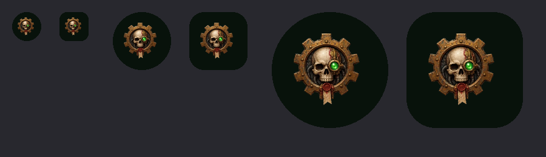
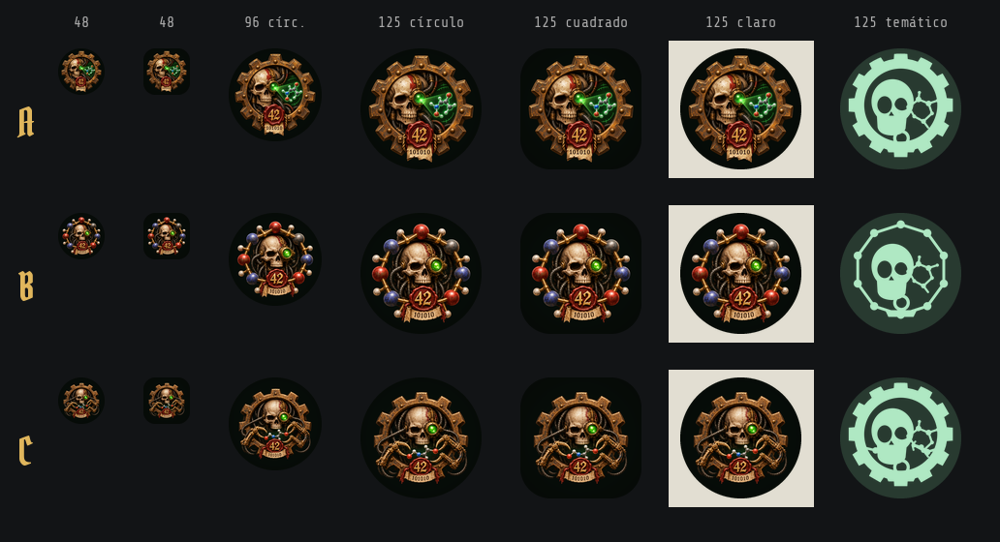
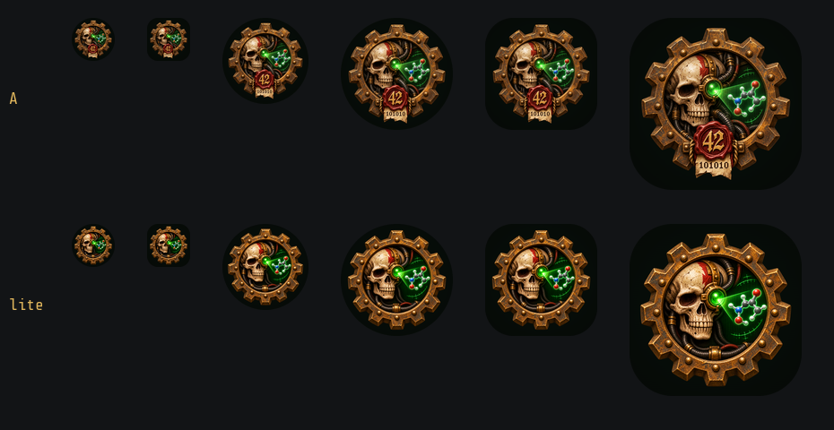
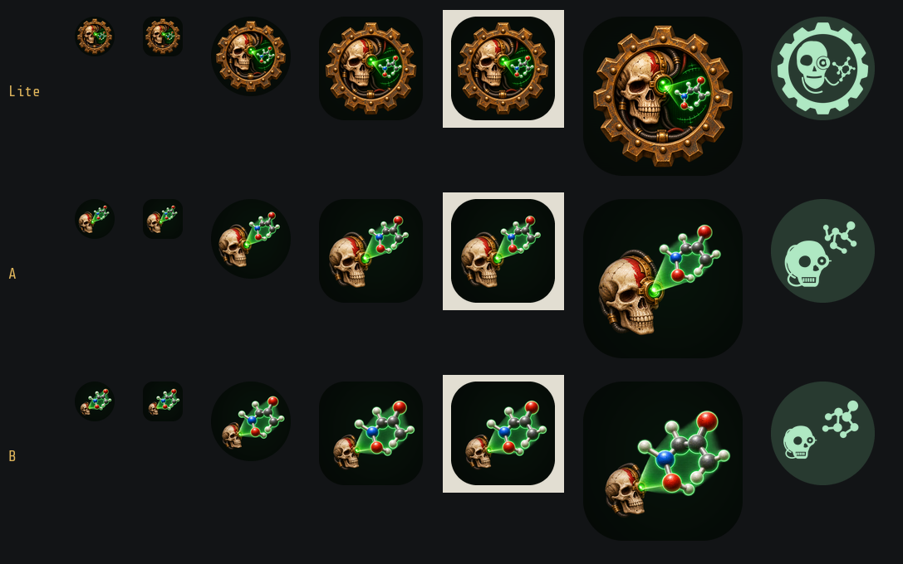

# 08d · Icono v3: el cráneo del arranque, el 42 y el ligando

> **Estado:** generado (variante **A, «Hologram»**) e **integrado** en dos versiones: el **emblema completo** (con rueda, «42» y `101010`) en la pantalla de arranque y, como icono del lanzador, la **cuarta vuelta**: solo el cráneo y el holograma, sin rueda (sección 12.3). Comprobado con guion (zona segura, canal alfa, halo) y con el compilador contra los *stubs*; **sin probar en el móvil**. Las medidas del icono adaptativo salen de la documentación de Android; las del A33 son **cálculo**, no medición.

## Índice

1. [Qué se pide](#1-qué-se-pide)
2. [El punto de partida: el arte del arranque como icono](#2-el-punto-de-partida-el-arte-del-arranque-como-icono)
3. [Teoría: cómo es un icono de Android](#3-teoría-cómo-es-un-icono-de-android)
4. [Qué cabe en 48 píxeles: jerarquía](#4-qué-cabe-en-48-píxeles-jerarquía)
5. [El «42»: por qué números propios y no el logotipo](#5-el-42-por-qué-números-propios-y-no-el-logotipo)
6. [Tres composiciones](#6-tres-composiciones)
7. [El *prompt*](#7-el-prompt)
8. [Qué hacer con lo que devuelva el generador](#8-qué-hacer-con-lo-que-devuelva-el-generador)
9. [Trampas](#9-trampas)
10. [Alternativas](#10-alternativas)
11. [Lo que devolvió el generador](#11-lo-que-devolvió-el-generador)
12. [Dos versiones: emblema completo e icono simplificado](#12-dos-versiones-emblema-completo-e-icono-simplificado)
13. [La integración, paso a paso](#13-la-integración-paso-a-paso)
14. [Decisión](#14-decisión)
15. [Qué recordar](#15-qué-recordar)

---

## 1. Qué se pide

- **El enunciado** (documento 01, VI.1): *«Icono acorde con el tema (molecular, científico o médico), con todas las resoluciones necesarias»*.
- **Lo que queremos:** que el icono sea el **cráneo en la rueda dentada** de la pantalla de arranque (`art_skull_cog_art`), mucho más vistoso que el icono plano v2, y que además lleve **el 42** (la escuela) y **una referencia al ligando** (el tema del proyecto: así el icono cumple el «acorde con el tema» por sí mismo, no solo por el estilo).

Una precisión de nombres: en el arranque sale el **cráneo con ojo biónico verde dentro de una rueda dentada**; el **servidor** (*servitor*) es la figura encorvada sobre la consola (`art_servitor`). Para un icono, el cráneo es la elección correcta: una figura entera con brazos, cables y velas a 48 píxeles es papilla. Lo que sí tomamos del servidor son los **rasgos**: implantes, cables, rejilla vocal.

---

## 2. El punto de partida: el arte del arranque como icono

Prueba hecha: el arte actual, sin tocar, metido en el círculo seguro (sección 3) sobre fondo de consola y recortado con máscaras redonda y cuadrada, a 48, 96 y 192 píxeles.



**Resultado:** se lee bien incluso a 48 px: rueda de bronce, cráneo claro y **el ojo verde**, que es el punto de mayor contraste. Problemas:

- **Queda pequeño:** la cinta de pergamino de abajo alarga la figura; al encajarla entera en el círculo, la rueda ocupa menos de lo que podría.
- **No hay ni 42 ni molécula.** Es Warhammer, pero no dice «proteínas».
- **Es un único PNG** con el fondo transparente: no hay capa de fondo propia ni versión monocroma.

Conclusión: la **dirección** es buena y ya está probada; falta una **composición pensada para icono**.

---

## 3. Teoría: cómo es un icono de Android

**Icono adaptativo** (Android 8+, API 26): dos capas de **108 × 108 dp**, *fondo* y *primer plano*. El lanzador las apila y las recorta con **su** máscara (círculo, cuadrado redondeado, «squircle»… depende del fabricante; Samsung usa el cuadrado redondeado). Además puede moverlas un poco por separado (paralaje) al tocarlas.

| Zona | Tamaño | En un lienzo de 1024 px | Qué va ahí |
|------|--------|-------------------------|------------|
| Lienzo completo | 108 dp | 1024 px | Solo margen: se recorta |
| Zona visible | 72 dp (cuadrado central) | 683 px | Lo que la máscara puede dejar ver |
| **Círculo seguro** | **66 dp** de diámetro | **626 px** | **Todo lo importante**: ninguna máscara lo recorta |

- **Monocromo** (Android 13+, «iconos temáticos»): una tercera capa de una sola tinta; el sistema la colorea con la paleta del fondo de pantalla. Si falta, el icono sale con sus colores aunque el usuario active los iconos temáticos.
- **Icono antiguo** (API 24–25, que soportamos: `minSdk 24`): un PNG de **48 × 48 dp** por densidad (`mipmap-mdpi` 48 px … `mipmap-xxxhdpi` 192 px), cuadrado y redondo.
- **Splash del sistema** (Android 12+): usa `windowSplashScreenAnimatedIcon`, que apunta al primer plano del icono (hoy `@mipmap/ic_launcher_foreground`, `themes.xml`). El sistema lo recorta a un círculo de **2/3** del lienzo. Nuestro contenido va en el 61 % (66/108), así que cabe.

**Tamaño real:** el A33 tiene una densidad de unos 2,6× (≈ 411 ppp, cálculo), así que el icono de 48 dp mide **≈ 125 px físicos**. El caso peor (48 px) es el de pantallas `mdpi`, raras hoy, pero es la prueba de que la silueta funciona.

---

## 4. Qué cabe en 48 píxeles: jerarquía

No todo cabe igual de legible; hay que decidir **qué se ve a qué tamaño**:

| Nivel | Elemento | Debe leerse a… |
|-------|----------|----------------|
| 1 | Silueta: **cráneo dentro de la rueda dentada** | 48 px |
| 2 | **Ojo verde** (punto de máximo contraste) | 48 px |
| 3 | **Molécula** de bolas y varillas, colores CPK | 96 px (a 48, una mancha de puntos de colores: suficiente) |
| 4 | **«42»** grabado | 125–192 px (el tamaño real en el móvil) |
| 5 | Detalle: remaches, cables, `101010` en la cinta | 192 px o más; a menos, textura |

La regla para el generador: **pocos elementos grandes**, contraste alto entre el hueso claro, el bronce medio y el fondo oscuro; nada de letras pequeñas que tengan que leerse.

---

## 5. El «42»: por qué números propios y no el logotipo

El logotipo oficial de 42 es un «42» geométrico, de palo seco, plano. Meterlo tal cual en un icono pictórico y gótico **chocaría** (dos estilos peleándose) y además es la marca de la escuela. La alternativa, mejor para el tema:

- **«42» con números propios**, grabados en latón o estampados en el **sello de lacre** rojo, al estilo Mechanicus.
- **`101010`** en la cinta de pergamino: es **42 en binario** (32 + 8 + 2), y el binario es la «lengua sagrada» (*binharic*) del Mechanicus. Una referencia doble que un evaluador de 42 pilla al momento.

---

## 6. Tres composiciones

Se piden las tres; se elige mirando las vistas previas a 48/96/192 px.

| | Composición | Ligando | 42 | A favor | En contra |
|---|-------------|---------|----|---------|-----------|
| **A** | Cráneo en la rueda; **del ojo sale un haz verde** que proyecta un holograma de una molécula pequeña sobre la frente o al lado | Holograma (bolas CPK + contorno verde) | Sello de lacre | Cuenta una historia: el cogitador «escanea» el ligando, que es lo que hace la app | El holograma puede emborronarse a 48 px |
| **B** | **La rueda dentada es una molécula:** los dientes son átomos (bolas CPK) unidos por varillas de latón formando un anillo, con el cráneo dentro | Anillo de bolas y varillas | Grabado en la frente o en el sello | Silueta única y muy legible; la molécula es la estructura, no un añadido | Se pierde la rueda clásica del Mechanicus |
| **C** | Cráneo en la rueda; **mecadendritas** (brazos mecánicos) que **sostienen** una molécula delante de la mandíbula | Molécula sujeta | Sello | Muy «servidor» | Más elementos: riesgo de saturar |

---

## 7. El *prompt*

En inglés, como el de la v2 (documento 08a): los generadores entienden mejor el vocabulario del género en inglés. **Adjuntar** al generador dos imágenes:

1. [`img_08d_referencia_estilo.png`](img_08d_referencia_estilo.png): `art_skull_cog_art` sobre fondo oscuro (referencia de **estilo**: mismo pincel, misma paleta).
2. [`img_08d_zonas_seguras.png`](img_08d_zonas_seguras.png): la plantilla de zonas (lienzo 1024 px con el cuadrado visible y el círculo seguro marcados).

```text
# App icon brief — "Swifty Proteins" (Android adaptive icon), v3

## What it is
An Android app that shows 3D molecules ("ligands") as balls and sticks. Its whole UI is styled as a
Warhammer 40,000 Adeptus Mechanicus cogitator terminal (grimdark, gothic-industrial, bronze, bone,
phosphor-green CRT). It is a student project of the coding school "42". The icon must say three things
at once: MECHANICUS (skull + cog + green bionic optic), MOLECULE (a small ball-and-stick ligand),
and 42 (the school).

## Style reference (attached image 1)
Match the attached skull-in-cog artwork EXACTLY in style: painterly, detailed but with bold readable
shapes, worn and scratched bronze cog with rivets, aged bone-coloured skull, a brass bionic eyepiece with
a glowing PHOSPHOR-GREEN lens (#43E07A), cables behind the skull, a red wax purity seal (#8E1B14) with a
parchment strip. Keep this look. Do NOT redesign it into flat, cartoon, vector, or clean sci-fi.

## Composition — make THREE variants
A. HOLOGRAM: skull in the cog; the green optic projects a thin green scanning beam that forms a small
   floating hologram of a ball-and-stick molecule (5–7 atoms) beside or above the skull. The atom balls
   keep their CPK colours (carbon dark grey, oxygen red, nitrogen blue, hydrogen white) with a faint green
   holographic outline.
B. MOLECULAR COG: the cog itself is built as a ring molecule: its teeth are atom balls (CPK colours)
   joined by brass rods (bonds); the skull sits inside the ring with its green optic.
C. MECHADENDRITES: skull in the cog; two thin mechanical tendrils hold a small ball-and-stick molecule in
   front of the jaw.

## The "42"
- Put the number "42" as ENGRAVED or STAMPED numerals, Mechanicus style (gothic / blackletter-inspired
  numerals in bone or brass), on the red wax seal OR engraved on the brass of the cog. Original lettering:
  do NOT copy any existing logo.
- On the parchment strip, write the binary "101010" (which is 42 in binary). Plain, short, centred.
- These are the ONLY texts in the icon. No app name, no other words.

## Legibility rules (most important)
- The icon is seen at 48 px (worst case) and about 125 px on a real phone. At 48 px the silhouette
  "skull inside a cog with a green eye" must still read clearly.
- Few big shapes, strong value contrast: light bone skull, mid-tone bronze, dark background. The green
  optic is the brightest point of the whole icon.
- Fill the safe circle: the cog should be as big as the safe circle allows (see canvas rules), not a
  small medallion in a big empty field. Make the parchment strip short so it does not stretch the
  figure vertically.

## Canvas rules (adaptive icon; attached image 2 shows the zones)
- Canvas 1024 × 1024 px = 108 dp.
- ALL key content (cog, skull, eye, molecule, 42) inside the CENTRAL CIRCLE of 626 px diameter
  (66 dp). Launchers crop with circles, squircles or rounded squares; anything outside that circle
  may be cut off.
- Nothing important outside the central 683 × 683 px square (72 dp). Outside it: empty.

## Deliverables (per variant)
1. ic_launcher_foreground.png — 1024 × 1024, RGBA with REAL transparency. Only the emblem. Clean, hard,
   dark-friendly edges: NO white or grey halo, NO glow fringe onto transparent pixels, NO painted
   checkerboard pretending to be transparency.
2. ic_launcher_background.png — 1024 × 1024, fully opaque. Very dark and calm: abyss #050806 to
   console #08120B, at most a soft green vignette or faint scanlines in the centre. No details that
   matter (it gets cropped and shifted).
3. ic_launcher_monochrome.png — 1024 × 1024, a single-colour (white on transparent) SIMPLIFIED
   silhouette of the same emblem (cog + skull + eye socket + molecule), used by Android 13 themed icons.
   Same size and position as the foreground.
4. preview sheet — the foreground over the background, shown in a circle mask, a squircle mask and a
   rounded-square mask, each at 48, 96 and 192 px, on light and on dark wallpaper.
5. composite_on_dark.png — the foreground alone over #050806, 1024 px, so edge halos are visible.

## Avoid
Flat or vector look, cartoon, glossy 3D plastic, clean futuristic sci-fi, steampunk (goggles, top hats,
sepia leather), any official logo, any text other than "42" and "101010", tiny details that only exist
at full size, white edge halos.
```

---

## 8. Qué hacer con lo que devuelva el generador

El plan, para cuando lleguen las imágenes:

1. **Revisión** con las vistas previas: elegir A, B o C (o mezclar).
2. **Limpieza del borde** con el mismo procedimiento que el resto del arte (documento 08c, 3): medir el halo sobre fondo oscuro, quitarlo y difuminar 2 px. Esta vez se pide sin halo, pero **se comprueba igual**.
3. **Medir la zona segura con un guion**: el radio máximo de los píxeles opacos del primer plano respecto al centro debe ser ≤ 313 px (626 / 2) en el lienzo de 1024. Es una comprobación numérica, no a ojo.
4. **Exportar por densidad** (WebP sin pérdida o PNG):

   | Carpeta | Capas adaptativas (108 dp) | Icono antiguo (48 dp) |
   |---------|----------------------------|-----------------------|
   | `mipmap-mdpi` | 108 px | 48 px |
   | `mipmap-hdpi` | 162 px | 72 px |
   | `mipmap-xhdpi` | 216 px | 96 px |
   | `mipmap-xxhdpi` | 324 px | 144 px |
   | `mipmap-xxxhdpi` | 432 px | 192 px |

5. **`mipmap-anydpi-v26/ic_launcher.xml`** (y `_round`): las tres capas pasan de `@drawable/…` (vectores) a `@mipmap/…` (mapas de bits).
6. **Monocromo:** el PNG del generador, o mejor, **vectorizado** (una silueta simple se convierte bien a vector y escala sin pérdida).
7. **Splash del sistema:** `windowSplashScreenAnimatedIcon` debe seguir apuntando al primer plano nuevo; comprobar en el móvil que el recorte circular no se come nada.
8. **Iconos antiguos** (`ic_launcher.png`, `ic_launcher_round.png`): se generan **con un guion** a partir de fondo + primer plano, recortados con su máscara; no hace falta pedirlos al generador.

---

## 9. Trampas

1. **El halo otra vez:** los generadores «inventan» transparencia con bordes claros. Se pide explícitamente y se comprueba sobre fondo oscuro (entrega 5).
2. **Tablero de ajedrez pintado:** a veces la «transparencia» es un dibujo gris y blanco dentro de un PNG opaco. Se comprueba que el canal alfa existe y tiene valores 0.
3. **Texto ilegible:** cualquier letra que deba leerse a 48 px fracasa. Por eso solo «42» y `101010`, y ninguno es imprescindible a ese tamaño (jerarquía, sección 4).
4. **El generador ignora el círculo seguro:** lo más habitual. La medición numérica del paso 3 lo detecta; si se sale, se reescala el primer plano (con cuidado de no dejarlo pequeño).
5. **Mapas de bits en `drawable/` sin densidad:** el sistema los escalaría desde `mdpi` y saldrían borrosos. Van en `mipmap-<densidad>`.
6. **Caché del lanzador:** al cambiar el icono, algunos lanzadores (Samsung incluido) siguen mostrando el viejo hasta reiniciar el lanzador o desinstalar. No es un fallo nuestro.

---

## 10. Alternativas

| Opción | Cómo | A favor | En contra |
|--------|------|---------|-----------|
| **Arte actual tal cual** | `art_skull_cog_art` como primer plano + fondo de consola | Funciona **ya**, probado a 48/96/192 px | Sin 42 ni ligando: el «acorde con el tema» queda flojo |
| **Composición a mano** | Arte actual + molécula y «42» dibujados por código encima | Sin generador; control total | Mezcla pintura y vector: suele verse pegado |
| **Generador** (elegida) | El *prompt* de la sección 7 | Una pieza coherente con todo dentro | Hay que limpiar y medir el resultado |
| **Vector redibujado** | Trazar el cráneo a mano en vector | Nítido a cualquier tamaño | Mucho trabajo y pierde el aspecto pictórico, que es lo que gusta |

La primera sirve de **plan B**: si el generador no da algo mejor, se integra el arte actual en una hora.

---

## 11. Lo que devolvió el generador

Un paquete por variante (A, B, C): primer plano, fondo y monocromo en 1024 px (el monocromo también en SVG), el primer plano sobre `#050806`, hojas de vistas previas y un `manifest.json` con sus propias medidas. El propio generador avisa de algo importante: **A es una ilustración hecha a propósito; B y C están recortadas** de una hoja de conceptos y reescaladas (menos nitidez).

### 11.1 Medido por nosotros (no nos fiamos del `manifest.json`)

| Comprobación | A | B | C | Límite |
|--------------|---|---|---|--------|
| Radio máximo de un píxel opaco (px) | 306,5 | 308,0 | 307,9 | ≤ 313 (círculo seguro) |
| Píxeles totalmente transparentes | 76 % | 79 % | 80 % | > 0: hay **alfa de verdad**, no un tablero pintado |
| Luminancia media del borde semitransparente (0–255) | 58 | 15 | 17 | Baja = **sin halo blanco** |
| Fondo | opaco, luminancia 6,9–14,2 | igual | igual | Oscuro y tranquilo |
| Monocromo | solo blanco | solo blanco | solo blanco | Una tinta |

Las tres pasan. El borde de A es algo más claro (58) porque el bronce del borde es claro, no por un halo: se ve en la composición sobre oscuro.

### 11.2 La trampa de sus vistas previas

Sus hojas recortan **el lienzo entero de 108 dp** con la máscara. Un lanzador real recorta **la zona visible de 72 dp** (sección 3): el icono se ve **1,5 veces más grande** de lo que enseñan. Hicimos nuestra propia hoja, recortando como el lanzador:



### 11.3 Lectura a tamaño real

- **A:** a 48 px se leen la rueda, el cráneo y el bloque verde del holograma (el único acento fuerte: bien). A 125 px (el A33) el «42» se lee; `101010` es ya **textura** (letras de unos 4 px).
- **B:** a 48 px es un **collar de cuentas de colores**: la silueta de rueda desaparece. Lo más vistoso a 1024 px y lo peor a 48.
- **C:** la molécula es pequeña y oscura; a 96 px ya no se distingue. Es la variante que menos dice «molécula».
- **Monocromo de A:** el PNG trae el **diente de arriba recortado** (489 píxeles distintos entre las filas 196–254 frente a su propio SVG). Se usa el **SVG**.

**Elegida: A.** También era la favorita del generador.

---

## 12. Dos versiones: emblema completo e icono simplificado

Con cinco elementos (rueda, cráneo, holograma, sello, cinta), A a 1024 px es una pieza preciosa, pero como icono va **cargada**. La solución acordada:

| Versión | Dónde | Por qué ahí |
|---------|-------|-------------|
| **Emblema completo** (A tal cual) | Pantalla de arranque, a 240 dp (≈ 620 px físicos en el A33) | A ese tamaño se lee **todo**: «42», `101010`, átomos. Además mide 590 px de origen, frente a los ~424 del arte anterior: **más nítido** |
| **Icono simplificado** (A sin sello ni cinta) | Lanzador | Una idea y un acento: rueda, cráneo, ojo, holograma. Figura **redonda** que llena el círculo |

Es lo que hacen las marcas: un **emblema completo** para piezas grandes y un **signo** simplificado para tamaños pequeños.

**¿Por qué no recortamos nosotros el sello?** Porque el sello **tapa** la parte de abajo de la rueda y los cables: al quitarlo queda un agujero que habría que pintar a mano, y un parche pintado sobre una ilustración se nota. Se pide al generador.

Mientras llegaba, el icono fue el emblema completo (pasaba todas las mediciones); al llegar la versión simplificada se **sustituyeron solo ficheros** (sección 12.1).

*Prompt* de seguimiento (adjuntar `composite_on_dark.png` de A):

```text
Follow-up to the Swifty Proteins icon v3, variant A "Hologram" (attached). We keep it as the full emblem.
Now make a SIMPLIFIED launcher version of the SAME artwork (same painting style, same skull, same cog,
same green optic and hologram molecule):
- REMOVE the red wax seal "42" and the parchment strip "101010" completely; repaint the lower part of
  the cog ring and the cables behind them so nothing looks cut out.
- The composition becomes ROUND: the cog fills the safe circle (diameter 626 px on the 1024 px canvas)
  as much as possible, centred.
- Keep the hologram (green beam + 5–7 CPK atoms) as the single bright accent. Fewer cables if needed.
- Optional, only if it stays subtle: the numerals "42" small and engraved into the brass of the cog
  ring, as texture (it does not need to be readable at 48 px).
Deliver the same files as before: foreground (RGBA, real transparency, no halo), background, monochrome
(SVG + PNG, the SVG must match the PNG), composite on #050806. In the previews, mask the VISIBLE 72 dp area
(the central 683 × 683 px), not the whole 108 dp canvas.
```

### 12.1 La versión simplificada: medida e integrada

El generador quitó sello y cinta y **repintó** la parte de abajo de la rueda y los cables (no hay agujero ni parche visible). Dejó fuera el «42» grabado: era opcional en el *prompt* y lo omitió por legibilidad a 48 px; el 42 vive en el emblema del arranque.

| Comprobación | Resultado | Límite |
|--------------|-----------|--------|
| Radio máximo de un píxel opaco | 305,3 px | ≤ 313 |
| Píxeles totalmente transparentes | 75 % | alfa de verdad |
| Luminancia media del borde semitransparente | 54 | sin halo |
| Monocromo: SVG frente a su PNG | 0 píxeles distintos | idénticos (el de la v3 completa no lo era) |
| Monocromo: SVG frente a nuestro vector aplanado | máx. 2/255 | conversión exacta |



A tamaño real la diferencia se ve sola: la figura es **redonda y llena el círculo**; el cráneo y el holograma salen más grandes; a 48 px ya no hay una mancha roja abajo compitiendo con el verde. El monocromo nuevo también es mejor: la órbita del ojo y la mandíbula se distinguen.

Ficheros sustituidos: `mipmap-<densidad>/ic_launcher_foreground.webp` y `ic_launcher_background.webp`, los iconos antiguos (`ic_launcher.png`, `ic_launcher_round.png`) y `drawable/ic_launcher_monochrome.xml`. El emblema del arranque (`art_emblem_hologram.webp`) **no cambia**. La *splash* del sistema muestra ahora la versión simplificada (apunta al primer plano del icono).

### 12.2 Tercera vuelta: sin rueda

**El problema:** sin sello ni cinta el icono mejoró mucho, pero en el móvil sigue **demasiado denso**: rueda con remaches, fondo oscuro con cables, cráneo, haz y molécula. La rueda es el elemento que **más superficie ocupa y menos información da** (el cráneo con implantes ya dice «Mechanicus» por sí solo).

**La decisión:** en el **icono** se quita la rueda; quedan el **cráneo** y la **proyección de la molécula**, y la molécula gana peso (es lo que hace la app). La rueda **no desaparece del proyecto**: sigue en el emblema completo del arranque y en el emblema de la cabecera. El icono es el signo mínimo; el emblema, la versión completa (sección 12).

**Riesgos de quitar la rueda:**

| Riesgo | Por qué | Qué se pide para evitarlo |
|--------|---------|---------------------------|
| **Leerse como «tóxico»** | Una calavera junto a una estructura química es, literalmente, el pictograma de peligro de toxicidad | Sin tibias cruzadas, sin rombos ni triángulos de aviso, sin verde «veneno» goteante; el cráneo claramente **cibernético** y el verde como **pantalla holográfica** |
| **Silueta menos redonda** | La rueda llenaba el círculo; un cráneo y una molécula no | Composición **en diagonal** que use el círculo; nada cortado en el borde |
| **Objeto pequeño en un campo vacío** | Sin marco, el generador tiende a dejar la figura pequeña | Pedido explícito: molécula del tamaño del cráneo, llenar el círculo |
| **Pierde «Mechanicus»** | La rueda era el símbolo más reconocible | Se mantienen el ocular de latón, la placa y unos pocos cables; el fondo puede llevar una rejilla de consola muy tenue |

Se piden **dos composiciones**: en diagonal (cráneo y molécula con el mismo peso) y «molécula primero» (la molécula protagonista, el cráneo como escáner).

*Prompt* (adjuntar `composite_on_dark.png` de la versión simplificada):

```text
Follow-up to the Swifty Proteins icon v3 "Hologram Lite" (attached). The painting is right, but as a
launcher icon it is still too DENSE. Remove the cog. Keep only the SKULL and the HOLOGRAM.

## What stays (same painting style, same skull, same light)
- The same aged bone skull with the brass bionic eyepiece and its glowing PHOSPHOR-GREEN lens (#43E07A),
  the small brass plate and the red marking on the cranium, a FEW short cables at the back of the skull
  (they say "machine", but they must not become a mass).
- The green scanning beam from the lens, and the HOLOGRAM of a ball-and-stick molecule.

## What goes
- The cog ring, its rivets and everything inside it (the dark backing, the cable bundle). No frame, no
  ring, no badge shape around the composition. No seal, no strip, no text, no numbers.

## The molecule gets MORE focus
- Make the hologram molecule bigger: roughly as big as the skull. 6–8 atoms, clear 3D ball-and-stick,
  CPK colours (carbon dark grey, oxygen red, nitrogen blue, hydrogen white), each atom with a thin
  green holographic rim; bonds as light sticks. Sharp and readable: at 48 px the molecule must still read
  as "coloured balls joined by sticks".
- The beam is a soft, semi-transparent green cone from the lens to the molecule, with a few faint scan
  lines. It must not hide the atoms.

## Composition — make TWO variants
1. DIAGONAL: the skull in three-quarter view, lower-left; the beam goes up-right to the molecule,
   upper-right. Skull and molecule about the same visual weight.
2. MOLECULE FIRST: the molecule large in the centre-right; the skull smaller, lower-left, looking at it.
   The molecule is the hero, the skull is the "scanner".

## Do NOT let it read as a poison / toxic warning
A skull next to a chemical structure can look like the hazard symbol for "toxic". Avoid that:
no crossbones, no toxic-green slime or dripping, no warning-sign shapes (diamonds, triangles). The skull
must clearly be a CYBERNETIC scanner (bionic eye, brass, cables) and the green must read as a
holographic DISPLAY (light, scan lines), not as poison.

## Canvas rules (unchanged)
- 1024 × 1024 px = 108 dp. ALL content inside the central circle of 626 px diameter. Without the cog the
  shape is no longer round: use the circle well (diagonal composition), do not leave it a small object in
  an empty field, and do not cut any part at the circle edge.
- Strong value contrast: light bone, bright green lens and hologram, dark background.

## Deliverables (per variant, same as before)
1. ic_launcher_foreground.png — 1024 × 1024 RGBA, real transparency, no halo. The beam may be
   semi-transparent (soft alpha), but no white or grey fringe around the skull.
2. ic_launcher_background.png — 1024 × 1024, opaque, very dark (#050806 to #08120B). May carry a very
   faint green console grid or scanlines in the centre (now that the cog is gone, a hint of "screen"
   behind the hologram helps), nothing that competes with the skull.
3. ic_launcher_monochrome.svg + .png — white on transparent, simplified silhouette: skull (with the eye
   socket and the eyepiece ring) + molecule (balls and sticks). The PNG rendered from the SVG.
4. composite_on_dark.png and a preview sheet: circle, squircle and rounded-square masks at 48, 96 and
   192 px, cropping the VISIBLE 72 dp area (the central 683 × 683 px), on dark and light wallpaper.
```

### 12.3 Cuarta vuelta: cráneo y holograma (la que se queda)

Llegaron dos composiciones: **A, en diagonal** (cráneo abajo a la izquierda, molécula arriba a la derecha, mismo peso) y **B, «molécula primero»** (molécula grande, cráneo pequeño).

| Comprobación | A | B | Límite |
|--------------|---|---|--------|
| Radio máximo de un píxel con algo de alfa | 303,6 px | 303,8 px | ≤ 313 |
| Píxeles totalmente transparentes | 88 % | 88 % | alfa de verdad |
| Luminancia media del borde semitransparente **del cráneo** (sin el haz) | 44 | — | sin halo |
| Monocromo: SVG frente a su PNG | 0 píxeles distintos | 0 | idénticos |
| Superficie opaca dentro del círculo seguro | 37,5 % | 36,1 % | (la versión simplificada con rueda: 83,8 %) |

El borde semitransparente **total** sale con luminancia ~115: es el **haz y el resplandor verdes**, semitransparentes a propósito; por eso el halo se mide solo en el borde del cráneo.



**Elegida: A.**

- **A 48 px sigue siendo «nuestra»:** el cráneo es grande y claro, con el ojo verde; se lee «cráneo cibernético que escanea una molécula». En B, a 48 px, el cráneo es una mancha beige y queda **una molécula genérica**: el icono de cualquier app de química.
- **El haz cuenta la historia** (el escáner mira el ligando, que es lo que hace la app) porque cráneo y molécula pesan lo mismo.
- **Monocromo:** en A el cráneo con su ocular se reconoce; en B es un garabato.
- **«Tóxico»:** en A el ocular, el latón y el haz hacen del cráneo un **instrumento**; en B, un cráneo pequeño junto a una molécula grande se parece más a la etiqueta de peligro.

**Lo que se acepta a sabiendas:**

1. **Esquinas vacías.** Una composición en diagonal llena el 37 % del círculo frente al 84 % de la rueda: en la pantalla de inicio, junto a iconos redondos y densos, se verá **más ligero y algo más pequeño**. No se puede ampliar: cráneo y molécula ya tocan el borde del círculo en la diagonal. Es el precio de la ligereza buscada; se juzga en el móvil.
2. **El haz apunta algo alto:** el cono sale del ocular y cubre la parte **inferior izquierda** de la molécula, no su centro. Detalle de dibujo; si molesta en el móvil, se pide al generador corregir solo el ángulo.
3. **Menos «Mechanicus»** que con la rueda: lo sostienen el ocular, la placa de latón y la marca roja. La rueda sigue en el emblema del arranque y en la cabecera.

**Ficheros sustituidos:** los mismos que en la sección 12.1 (`mipmap-<densidad>/ic_launcher_foreground.webp` y `ic_launcher_background.webp`, los iconos antiguos y `drawable/ic_launcher_monochrome.xml`, convertido del SVG: diferencia 0 con el original). La *splash* del sistema muestra este primer plano.

---

## 13. La integración, paso a paso

| Fichero | Qué es | Cómo se hizo |
|---------|--------|--------------|
| `mipmap-<densidad>/ic_launcher_foreground.webp` | Primer plano (108 dp): 108, 162, 216, 324, 432 px | Reescalado Lanczos desde 1024; WebP con pérdida (calidad 92) **con alfa** |
| `mipmap-<densidad>/ic_launcher_background.webp` | Fondo (108 dp) | Igual; sin alfa (≈ 1 KB: es un degradado) |
| `drawable/ic_launcher_monochrome.xml` | Monocromo, **vector** | El SVG del generador con nuestro conversor (documento 08c, 5) |
| `mipmap-<densidad>/ic_launcher.png`, `ic_launcher_round.png` | Icono antiguo (48 dp, API 24–25): 48…192 px | **Guion:** fondo + primer plano, recorte de la zona visible (683 px centrales), máscara de cuadrado redondeado (radio 18 %) o círculo |
| `mipmap-anydpi-v26/ic_launcher*.xml` | Icono adaptativo | Capas de `@drawable/…` (vectores v2) a `@mipmap/…`; el monocromo sigue en `@drawable` |
| `values/themes.xml` | *Splash* del sistema | `windowSplashScreenAnimatedIcon` → `@mipmap/ic_launcher_foreground` |
| `drawable-nodpi/art_emblem_hologram.webp` | El emblema completo | Primer plano recortado a su contenido (590 × 603 px) |
| `ui/BootScreen.kt` | Pantalla de arranque | `art_skull_cog_art` (200 dp) → `art_emblem_hologram` (240 dp) |
| `drawable/ic_launcher_foreground.xml`, `ic_launcher_background.xml` | Vectores del icono v2 | **Borrados**: ya no los usa nadie (comprobado con `grep`) |

Detalles que merecen explicación:

- **¿Por qué `mipmap` y no `drawable`?** Los `mipmap-*` no se eliminan al generar paquetes por densidad, y el lanzador puede pedir el icono de **una densidad mayor** que la de la pantalla (lo hace para que se vea nítido). Es la carpeta pensada para iconos.
- **¿Por qué el monocromo como vector?** Es una silueta de 16 trazados: en vector pesa 4 KB, escala a cualquier tamaño y no hace falta exportarlo cinco veces. El conversor aprendió los colores con nombre (`white`, `black`), que este SVG usa, y se quitó un trazado de grosor 0 que no dibujaba nada. Verificado: el SVG aplanado frente al original difiere como mucho **8/255** en un píxel (suavizado de bordes).
- **240 dp con `size()`:** `size()` **respeta** el espacio que da el panel; en una pantalla baja el emblema se encoge en vez de desbordar (a diferencia de `requiredSize()`).
- **Peso total:** ≈ 556 KB entre todas las capas, los iconos antiguos y el emblema (156 KB).

**Comprobado aquí:** compilación contra los *stubs* sin errores, con un **control negativo** (el mismo código con un recurso mal escrito, `art_emblem_hologramX`, **sí** falla), XML bien formado, y que ningún fichero apunta ya a los vectores borrados.

**Sin comprobar (no hay SDK de Android aquí):** que `aapt` acepte los recursos (no se espera problema: nombres válidos, sin duplicados entre `.png` y `.webp`), y todo lo visual en el móvil:

1. El icono en el lanzador de Samsung (cuadrado redondeado). **Si sigue el viejo**, es la caché del lanzador (sección 9, trampa 6): reiniciar el móvil o desinstalar.
2. Con los iconos temáticos activados (si la versión de One UI los ofrece), la silueta verde.
3. La *splash* del sistema (un instante) con el primer plano nuevo.
4. La pantalla de arranque: el emblema nítido, el «42» y `101010` legibles.

---

## 14. Decisión

| # | Decisión | Estado | Motivo |
|---|----------|--------|--------|
| D38 | El icono pasa a ser **pictórico**: el cráneo en la rueda, con **ligando** en holograma y **«42»** (números propios + `101010`), como icono adaptativo de mapas de bits; **dos versiones**: emblema completo en el arranque, icono simplificado en el lanzador | Decidida e integrada (emblema completo en el arranque; icono: cráneo + holograma, sección 12.3) | Mucho más reconocible que el icono plano; cumple «acorde con el tema» con la molécula; el 42 en binario conecta con el *binharic* del Mechanicus |

---

## 15. Qué recordar

- **Icono adaptativo:** lienzo de 108 dp, visible 72 dp, **lo importante en el círculo de 66 dp** (626 px de 1024).
- **Tres capas:** fondo, primer plano y **monocromo** (iconos temáticos de Android 13+); más el icono antiguo de 48 dp para API 24–25.
- **Jerarquía por tamaño:** a 48 px solo se lee la silueta y el ojo; el «42» es para el tamaño real (~125 px).
- **42 = `101010`** en binario.
- Lo que devuelva el generador **se mide** (radio del contenido, canal alfa, halo), no se integra a ojo.
- **Las vistas previas ajenas se comprueban:** recortar el lienzo entero en vez de la zona visible de 72 dp hace el icono 1,5 veces más pequeño de lo real.
- **Emblema completo para lo grande, signo simplificado para lo pequeño;** el signo se queda con lo que dice más por superficie (aquí: cráneo + molécula, sin rueda).
- **Calavera + química = pictograma de «tóxico»:** el contexto (implantes, holograma) tiene que dejar claro que no lo es.
- Iconos en **`mipmap-*`**; una silueta monocroma, mejor en **vector**.
