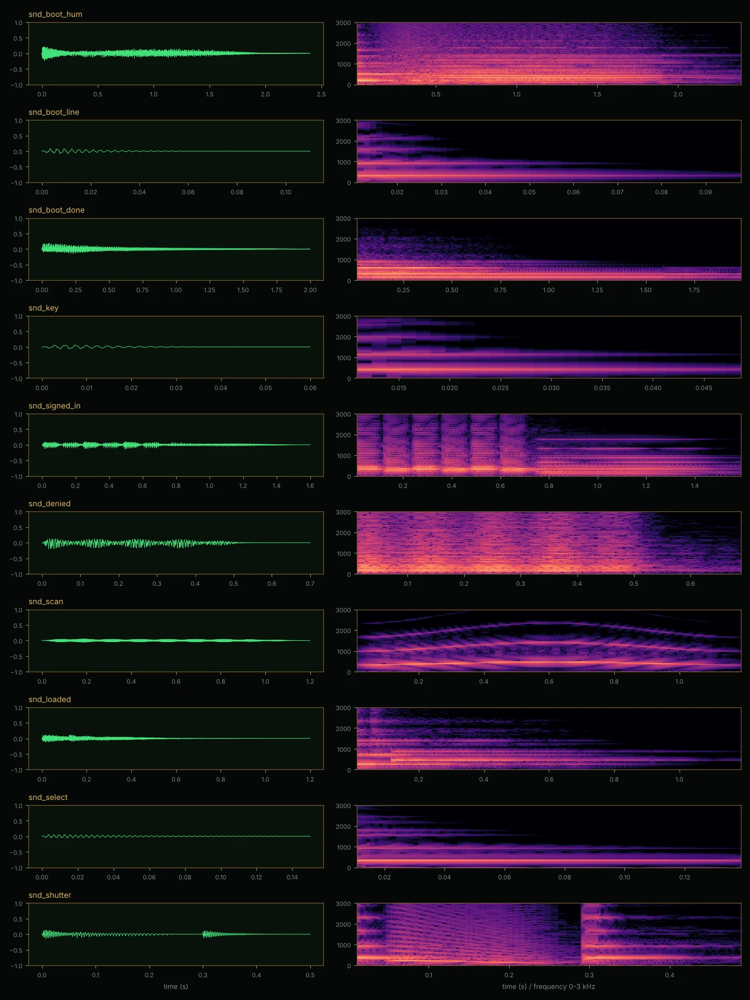

# 14 · Sonidos del cogitador: síntesis desde cero y reproducción

> **Estado:** **escrito**. Los diez sonidos están **generados** por `tools/sound/make_sounds.py` (numpy + scipy + ffmpeg) y guardados en `app/src/main/res/raw/`; el script es **reproducible byte a byte**. La regla de cuándo suena algo (`SoundGate`) y la etiqueta que evita repetir sonidos al girar la pantalla (`loadSoundTag`) están **probadas en la JVM** (8 + 5 pruebas, 10 mutantes muertos). El reproductor (`CogitatorSounds`) y los ganchos en las pantallas **compilan contra *stubs***; **sin oír en el móvil** (sección 9).

## Índice

1. [Qué pide el enunciado (y qué nos pedimos)](#1-qué-pide-el-enunciado-y-qué-nos-pedimos)
2. [Teoría: el sonido digital en cinco ideas](#2-teoría-el-sonido-digital-en-cinco-ideas)
3. [Las piezas de la síntesis](#3-las-piezas-de-la-síntesis)
4. [Las diez recetas](#4-las-diez-recetas)
5. [Verlos: forma de onda y espectrograma](#5-verlos-forma-de-onda-y-espectrograma)
6. [Del número al fichero: WAV → Ogg Vorbis](#6-del-número-al-fichero-wav--ogg-vorbis)
7. [Cómo suenan en la app](#7-cómo-suenan-en-la-app)
8. [Pruebas y mutación](#8-pruebas-y-mutación)
9. [Cómo probarlo en el móvil](#9-cómo-probarlo-en-el-móvil)
10. [Trampas](#10-trampas)
11. [Alternativas](#11-alternativas)
12. [Decisión](#12-decisión)
13. [Qué recordar](#13-qué-recordar)

---

## 1. Qué pide el enunciado (y qué nos pedimos)

- **El enunciado no pide sonido.** Es un añadido del equipo (documento 01, §15.4, punto 6): el cogitador de la dirección visual (documentos 08a y 08c) es una máquina que **zumba, teclea y responde**; sin sonido, la mitad de la ambientación se queda en la pantalla.
- **Requisitos que nos ponemos:**
  1. **Nada de muestras ajenas.** Ni grabaciones ni bancos de sonidos: cada sonido sale de **matemáticas** (osciladores, ruido, filtros, envolventes). Así no hay ninguna licencia que justificar, y el proceso se puede **explicar** en la defensa.
  2. **Reproducible:** el mismo script da los mismos ficheros, byte a byte.
  3. **Discreto:** cortos, por debajo del volumen máximo, y **nunca con el móvil en silencio o vibración** (la defensa es en una sala llena de gente).
  4. **Ligero:** los diez ficheros juntos pesan **69 KiB**.
  5. **Nunca bloquea nada:** si un sonido no está listo, no se espera; se pierde.

---

## 2. Teoría: el sonido digital en cinco ideas

**1. Muestreo.** Un sonido es una presión del aire que cambia con el tiempo. En digital se guarda como una lista de números (**muestras**), tomados a intervalos fijos. Usamos **44 100 muestras por segundo** (la frecuencia del CD). Un segundo de sonido = 44 100 números entre −1 y 1.

**2. Nyquist.** Con *N* muestras por segundo solo se pueden representar frecuencias hasta **N/2**: 22 050 Hz, por encima del oído humano (≈ 20 kHz). Una onda cuadrada «perfecta» tiene armónicos infinitos: los que pasan de 22 050 Hz se **pliegan** a frecuencias falsas (*aliasing*, un silbido metálico). Por eso nuestras ondas ricas en armónicos se **redondean** o se **filtran** (sección 3).

**3. Cuantización y dBFS.** El fichero guarda cada muestra como un entero de **16 bits** (−32 768 … 32 767). El máximo representable es **0 dBFS** (*decibelios relativos a la escala completa*). Los decibelios son logarítmicos: −6 dB ≈ la mitad de amplitud, −20 dB = una décima.

> Ejemplo: `finish(x, -14)` deja el pico de la tecla en 10^(−14/20) = **0,20** de la escala completa. El gruñido del arranque (`-4`) llega a 10^(−4/20) = **0,63**: el sonido más «grande» es el más fuerte, el de cada pulsación el más bajo.

**4. Clics.** Un salto brusco de la señal (empezar en 0,5 o cortar mientras aún suena) **contiene todas las frecuencias** a la vez: se oye un clic. Por eso cada sonido empieza y acaba en cero con un **fundido** de unos milisegundos. En el espectrograma un clic se ve como una **raya vertical** de arriba abajo.

**5. Espectrograma.** La forma de onda (amplitud frente a tiempo) dice poco del timbre. El **espectrograma** corta la señal en trocitos (512 muestras ≈ 11,6 ms), calcula en cada uno qué frecuencias hay (transformada de Fourier) y pinta: tiempo en horizontal, frecuencia en vertical, intensidad en color. Ahí se **ven** un barrido, un armónico o un clic.

---

## 3. Las piezas de la síntesis

Todo está en `tools/sound/make_sounds.py`. Cada pieza es una función de pocas líneas que devuelve un `numpy.ndarray` de muestras.

### 3.1 Osciladores: de dónde sale el tono

| Pieza | Fórmula | Timbre | Para qué |
|-------|---------|--------|----------|
| `sine(f)` | sen(fase) | Puro, sin armónicos | Pings, barridos, el «sonar» |
| `square(f, softness=6)` | tanh(6·sen(fase)) / tanh(6) | Zumbido hueco (solo armónicos impares), con los bordes **redondeados** | Los pitidos binarios del «101010», la tecla del arranque |
| `saw(f)` | 2·(p − ⌊p + ½⌋), p = fase/2π | Brillante y áspero (todos los armónicos) | Motores, zumbidos, el «no» |
| `noise(n)` | uniforme en [−1, 1] | Todas las frecuencias | Chasquidos, el «thunk», el siseo del servo |

**La fase acumulada** (`phase_of`) es el detalle que hace posibles los **glissandos** (frecuencia que cambia). La tentación es escribir `sin(2π·f(t)·t)`, pero eso es incorrecto cuando *f* varía: la frecuencia que se oye es la **derivada** de la fase, y la derivada de f(t)·t no es f(t). Lo correcto es **sumar** la frecuencia muestra a muestra:

```
fase[n] = 2π · (f[0] + f[1] + … + f[n]) / 44 100
```

> Simulación con números redondos: un tono de 1000 Hz avanza 2π·1000/44 100 = **0,1425 rad** por muestra. Si a mitad la frecuencia pasa a 2000 Hz, con la suma la fase sigue desde donde iba y avanza 0,285 rad por muestra: la onda se **comprime sin saltar**. Con `sin(2π·f·t)`, en ese instante el argumento salta de golpe de 2π·1000·t a 2π·2000·t: un **clic**.

**La cuadrada redondeada.** `tanh(k·sen)`: con *k* pequeño es casi un seno; con *k* grande, casi una cuadrada. Con *k* = 6 los bordes duran unas décimas de milisegundo: conserva el carácter de «pitido de máquina» sin el borde infinito que produciría *aliasing* y un sonido de juguete de 8 bits.

**El ruido con semilla.** `np.random.default_rng(42)`: el generador pseudoaleatorio con una semilla fija da **siempre la misma secuencia**. Por eso el ruido es «aleatorio» al oído pero idéntico en cada ejecución (y la semilla es 42, claro).

### 3.2 Filtros: esculpir el timbre

Filtros de **Butterworth** de orden 4 (`scipy.signal.butter` + `lfilter`): respuesta plana en la banda que pasa y caída de 24 dB por octava fuera.

| Filtro | Deja pasar | Uso |
|--------|-----------|-----|
| `lowpass(x, fc)` | Por debajo de *fc* | Domar la sierra (motor, zumbido); el «thunk» grave (180 Hz) |
| `highpass(x, fc)` | Por encima de *fc* | El chasquido seco de un contacto (ruido > 3 kHz) |
| `bandpass(x, lo, hi)` | Entre *lo* y *hi* | La tecla del teletipo (2–6 kHz), el siseo del servo (300–1200 Hz) |

La frecuencia de corte se da a scipy **normalizada** a Nyquist: `fc / (SR/2)`. Ejemplo: 900 Hz → 900 / 22 050 = **0,0408**.

### 3.3 Envolventes: cómo nace y muere el sonido

- **ADSR** (`adsr(n, a, d, s, r)`): **A**taque (de 0 a 1), **D**ecaimiento (de 1 al nivel S), **S**ostenimiento (nivel constante), **R**elajación (a 0). Tramos lineales. Es la envolvente clásica de los sintetizadores.
- **Caída exponencial** (`exp_decay(n, τ)` = e^(−t/τ)): cómo muere algo **golpeado** (una campana, un contacto). Con τ = 0,12 s, a los 0,12 s queda el 37 %, a 0,36 s el 5 %.
- **`fade_out`**: los últimos 12 ms van linealmente a cero. Una parte que se corta mientras suena (una campana a la que se le acaba el tiempo) daría un clic (§2, idea 4). Se descubrió así: el espectrograma de `snd_boot_done` mostraba una raya vertical al final de la primera campana.

### 3.4 Modulación de frecuencia (FM): las campanas

`fm_bell(f, s, ratio=1.41, index=3)`: una **portadora** (el tono que se oye) cuya fase empuja adelante y atrás una **moduladora**:

```
salida = sen(2π·f·t + I(t)·sen(2π·1,41·f·t))
```

- **Razón no entera (1,41 ≈ √2):** aparecen parciales en f ± k·1,41·f, que **no** son múltiplos de f. Eso es exactamente lo que distingue una campana (parciales inarmónicos) de una cuerda (armónicos).
- **Índice que decae** (de 3 hacia 0 con τ = s/3): el golpe es brillante y metálico; la cola, casi un seno puro. Así suena una campana real.
- Es la técnica del Yamaha DX7 (1983): mucho timbre con dos senos.

### 3.5 Mezcla y acabado

- **`place(total, (t0, x), (t1, y), …)`**: coloca cada parte en su instante y las **suma** en un búfer de la duración total.
- **`finish(x, pico_dB)`**: (1) resta la media (**componente continua**: una señal desplazada del cero desperdicia rango y da un golpe al empezar); (2) fundido de entrada y salida de 4 ms; (3) **normaliza el pico** a `pico_dB` dBFS. Normalizar el pico (no el volumen medio) garantiza que nada **satura**: ninguna muestra pasa de 1.

---

## 4. Las diez recetas

| Fichero | Momento | Duración | Pico | Receta en una línea |
|---------|---------|---------:|-----:|---------------------|
| `snd_boot_hum` | Aparece la pantalla de arranque | 1,60 s | −4 dBFS | Zumbido de red de 50 Hz + 3 armónicos que crece, sierra que «arranca» de 55 a 110 Hz, y el «thunk» de la bobina desmagnetizadora |
| `snd_boot_line` | Cada línea del arranque | 0,07 s | −10 | Ruido 2–6 kHz que muere en 8 ms + pitido cuadrado de 1,2 kHz |
| `snd_boot_done` | Aparece «> DONE» | 0,75 s | −6 | Dos campanas FM: Mi5 (659 Hz) y, 160 ms después, Si5 (988 Hz) |
| `snd_key` | Cualquier tecla o botón | 0,045 s | −14 | Relé: dos chasquidos separados 7 ms (rebote del contacto) sobre un golpe de 120 Hz |
| `snd_signed_in` | Sesión abierta | 0,60 s | −8 | **101010** (42 en binario) con seis pitidos y un glissando hacia arriba |
| `snd_denied` | Contraseña mala, bloqueo, carga fallida | 0,50 s | −8 | Dos zumbidos graves con trémolo de 30 Hz, el segundo más bajo |
| `snd_scan` | Cargando un ligando | 1,00 s | −12 | Seno que barre 500 → 1500 → 500 Hz con aleteo de 14 Hz + siseo de servo |
| `snd_loaded` | La molécula está lista | 0,70 s | −8 | *Ping* de sonar a 1760 Hz con cola larga y eco a 120 ms |
| `snd_select` | Se toca un átomo | 0,09 s | −14 | Seno que sube una tercera mayor (Do7 → Mi7) |
| `snd_shutter` | Compartir (captura) | 0,32 s | −9 | Chasquido, motor que se para (sierra 220 → 90 Hz), chasquido |

Los picos están **escalonados por importancia**: lo que se oye a cada momento (tecla, átomo) es lo más bajo; lo que ocurre una vez (arranque) lo más alto.

### 4.1 `snd_boot_hum`: el monitor de tubo que se enciende

```python
mains = sum(sine(np.full(n, 50.0 * k)) / k for k in (1, 2, 3, 4))      # 50, 100, 150, 200 Hz con amplitud 1, ½, ⅓, ¼
spin  = lowpass(saw(np.linspace(55, 110, n)), 900) * 0.6                # sierra que sube una octava, sin agudos
body  = (mains * 0.7 + spin) * adsr(n, 0.35, 0.3, 0.7, 0.6)             # crece 0,35 s, baja a 0,7, se apaga 0,6 s
thunk = lowpass(noise(0.25 s), 180) * exp_decay(…, 0.06) * 3            # golpe grave al principio
```

- **50 Hz** es la frecuencia de la red eléctrica en Europa: el zumbido de un transformador. Las amplitudes 1/k imitan el espectro de una onda de red algo distorsionada.
- **La sierra que sube de 55 a 110 Hz** es el «arranque» de algo que gira (el *flyback* de un CRT no gira, pero el oído lo lee como «la máquina cobra vida»).
- **El «thunk»**: los monitores de tubo tenían una **bobina desmagnetizadora** que al encender daba un golpe sordo. Ruido filtrado a 180 Hz que muere en ~0,15 s.

### 4.2 `snd_boot_line`: el teletipo

Ruido en la banda 2–6 kHz (el «tic» de una tecla mecánica está ahí) con τ = 8 ms, más un pitido cuadrado de 1,2 kHz de 20 ms a un 35 %. Suena con cada línea del arranque, cada **546 ms** (documento 08d): 70 ms de sonido y casi medio segundo de silencio, nunca se solapan.

### 4.3 `snd_boot_done`: dos campanas, una quinta

Mi5 (659,3 Hz) y Si5 (987,8 Hz): una **quinta justa ascendente** (razón 3:2). Es el intervalo de «resolución»: el oído lo entiende como «terminado, listo». Dos campanas FM (§3.4) separadas 160 ms; la segunda dura más.

### 4.4 `snd_key`: un relé

Un relé (o una tecla mecánica) no hace «clic» una vez: el contacto **rebota** y cierra dos o tres veces en pocos milisegundos. Dos ráfagas de 3 ms de ruido por encima de 3 kHz, la segunda al 60 % y 7 ms después, sobre un golpe de 120 Hz que muere en 12 ms (el cuerpo de la caja). Es el sonido que más se repite: el más corto (45 ms) y el más bajo (−14 dBFS).

### 4.5 `snd_signed_in`: la máquina dice «42»

```python
for i, bit in enumerate("101010"):              # 42 = 32 + 8 + 2 = 0b101010
    f = 1320.0 if bit == "1" else 880.0          # 1 agudo (Mi6), 0 grave (La5)
    parts.append((i * 0.065, lowpass(square(f), 4000) * adsr(n, 0.003, 0.01, 0.7, 0.012)))
glide = sine(np.linspace(1320, 2640, n)) …       # y una octava hacia arriba
```

Seis pitidos de 55 ms cada 65 ms: **agudo-grave-agudo-grave-agudo-grave**. Es el mismo «101010» del icono (documento 08d). El «binárico» del Culto de la Máquina es justo eso: la máquina habla en bits. Lo dice cada vez que alguien entra.

### 4.6 `snd_denied`: el espíritu de la máquina no está contento

Dos zumbidos de sierra filtrada a 1,4 kHz (150 Hz y después 112 Hz: **baja**, como un «no-o») con un **trémolo** de 30 Hz (el volumen oscila 0,5–1,0 treinta veces por segundo: suena **áspero**, como una bocina vieja). Grave a propósito: los «error» agudos son estridentes y cansan; este dice «no» sin chillar.

### 4.7 `snd_scan`: el auspex del cráneo servidor

La frecuencia sigue f(t) = 1000 + 500·sen(2π·t − π/2): empieza en 500 Hz, sube a 1500 a los 0,5 s y vuelve. Gracias a la fase acumulada (§3.1) el barrido es continuo. El volumen aletea a 14 Hz (±20 %), y debajo hay ruido de 300–1200 Hz al 35 %: el **servo** que mueve el sensor. Se corta en cuanto la carga termina (§7.3).

### 4.8 `snd_loaded`: el *ping*

Seno puro de 1760 Hz (La6) con ataque de 2 ms y cola exponencial τ = 120 ms, más un **eco** al 35 % 120 ms después. Es el lenguaje del sonar: «contacto». Después del barrido del 4.7, cierra la frase: buscar → encontrar.

### 4.9 `snd_select`: tocar un átomo

90 ms de seno que sube de Do7 (2093 Hz) a Mi7 (2637 Hz), una **tercera mayor** (razón 5:4). Agudo, suave y corto: se repite mucho y no puede molestar.

### 4.10 `snd_shutter`: la pict-captura

Chasquido de 6 ms (ruido por encima de 2,5 kHz), un motor que **frena** (sierra de 220 a 90 Hz filtrada a 1,5 kHz durante 180 ms) y otro chasquido a los 250 ms: el ciclo de una cámara mecánica. Suena al empezar a compartir, mientras se captura la imagen.

---

## 5. Verlos: forma de onda y espectrograma

`python3 tools/sound/make_sounds.py --plots hoja.png` dibuja los diez: forma de onda a la izquierda, espectrograma (0–8 kHz) a la derecha.



Qué buscar en la imagen:

- **`snd_boot_hum`:** rayas horizontales abajo (50, 100, 150, 200 Hz) y una mancha grave al principio (el «thunk»).
- **`snd_signed_in`:** **seis escalones** alternos arriba-abajo (1-0-1-0-1-0) y una línea que sube en diagonal: el «42» se **lee** en el espectrograma.
- **`snd_scan`:** un arco (sube y baja) sobre una banda difusa (el servo).
- **`snd_boot_done`:** dos «peines» de parciales que nacen anchos (índice FM alto) y se adelgazan hasta un solo tono.
- **Ninguna raya vertical** de arriba abajo al final de los sonidos: no hay clics.

---

## 6. Del número al fichero: WAV → Ogg Vorbis

1. **WAV PCM de 16 bits** (`write_wav`): cada muestra × 32 767, redondeada y recortada; mono, 44,1 kHz. Es el formato «sin pérdida» de partida.
2. **Ogg Vorbis, calidad 5** (`to_ogg`, ffmpeg con `libvorbis`): compresión con pérdida, de **tasa variable**. Calidad 5 es transparente para estos sonidos (no se distingue del WAV).
3. **Sin metadatos** (`-map_metadata -1`) y en **modo exacto** (`-fflags +bitexact -flags:a +bitexact`).

**¿Por qué Ogg Vorbis?** Android lo decodifica en **todas** las versiones (desde la 1), sin patentes, y `SoundPool` lo acepta. MP3 tiene un **retardo** al principio (el *encoder delay*, ~25 ms de silencio) que en un clic de tecla se nota. WAV sin comprimir pesaría ~1 MB en total. Opus sería más eficiente, pero su soporte en Android depende de la versión y del contenedor (Opus dentro de Ogg, solo en versiones recientes; **sin comprobar** el detalle), y el ahorro aquí es despreciable.

**El peso real.** Los diez ficheros: **69 KiB**. Curiosidad: `snd_key` dura 45 ms y pesa 4,5 KiB, casi como uno de 0,3 s. Un Vorbis lleva en su cabecera los **libros de códigos** del codificador (≈ 3,5–4 KiB) en **cada** fichero: en sonidos tan cortos la cabecera pesa más que el sonido. Por eso la «tasa de bits» que da `ffprobe` para los cortos (800 kbit/s en `snd_key`) no significa nada.

**Reproducibilidad, comprobada.** Dos ejecuciones dan:

- **WAV idénticos** (10 de 10): semilla fija del ruido, nada depende de la hora.
- Sin `bitexact`, **OGG distintos en 24 bytes**: el contenedor Ogg pone a cada flujo un **número de serie aleatorio** (y su suma de control cambia con él). El audio decodificado era idéntico, pero el fichero no, y `git` vería «cambios» cada vez. Con `bitexact` el número de serie es fijo: **OGG idénticos** (10 de 10).
- Matiz: «idéntico» con la **misma versión** de ffmpeg/libvorbis (aquí ffmpeg 6.1.1, numpy 2.5.3, scipy 1.18.1). Otra versión del codificador puede dar otros bytes con el mismo sonido.

**Regenerar:**

```bash
python3 tools/sound/make_sounds.py                       # escribe app/src/main/res/raw/snd_*.ogg
python3 tools/sound/make_sounds.py /tmp/x --wav-dir /tmp/w --plots /tmp/hoja.png   # para escuchar y mirar
```

---

## 7. Cómo suenan en la app

### 7.1 Las piezas

| Pieza | Fichero | Qué hace | Probada |
|-------|---------|----------|---------|
| `SoundCue` | `sound/SoundCue.kt` | Los diez sonidos, cada uno con su **intervalo mínimo** de repetición | JVM |
| `SoundPlayer` (+ `Silent`) | `sound/SoundCue.kt` | La interfaz que conocen las pantallas: `play`, `stop` | — |
| `SoundGate` | `sound/SoundCue.kt` | **Si** un sonido puede sonar ahora (silencio del móvil, intervalo) | JVM, 8 pruebas |
| `CogitatorSounds` | `sound/CogitatorSounds.kt` | El reproductor real con `SoundPool` | Compila (*stubs*) |
| `LocalSounds` | `sound/CogitatorSounds.kt` | Cómo llega el reproductor a cualquier pantalla de Compose | Compila |
| `SoundOnChange` | `sound/SoundOnChange.kt` | «Suena una vez por cambio **real**», también tras girar la pantalla (§7.4) | Compila |
| `loadSoundTag` | `sound/SoundTags.kt` | Nombre corto del estado de carga para `SoundOnChange` | JVM, 5 pruebas |

### 7.2 `SoundPool`: el reproductor de sonidos cortos

Android tiene varios reproductores; para efectos de interfaz el correcto es **`SoundPool`**:

- **Decodifica una vez** cada fichero a PCM en memoria (`load`), y `play` arranca en pocos milisegundos. `MediaPlayer` decodifica **cada vez**: decenas de milisegundos de retraso, inaceptable para un clic que tiene que coincidir con el dedo.
- **Varios a la vez** (`setMaxStreams(4)`): un clic de tecla mientras suena el barrido de carga.
- **`AudioAttributes`:** `USAGE_ASSISTANCE_SONIFICATION` + `CONTENT_TYPE_SONIFICATION` = «sonidos de la interfaz». Android los trata como los demás sonidos del sistema (no como música: no se mezclan con el reproductor de música del usuario ni piden el «foco de audio»).
- **Una sola instancia para toda la app** (`CogitatorSounds.of(context)`, *singleton* con doble comprobación y `@Volatile`), creada con el **contexto de la aplicación**: vive lo que vive el proceso, no retiene ninguna actividad (no hay fuga) y **no se recrea al girar** la pantalla (recargar los diez ficheros en cada giro sería tirar trabajo). Decodificados ocupan unos **500 KB** (5,7 s de audio en total × 44 100 muestras × 2 bytes).
- **Cada sonido → su fichero** con un `when` **sin `else`**: si mañana se añade un `SoundCue`, el código **no compila** hasta que tenga su `R.raw`. Y la prueba `everyCueHasItsSoundFile` comprueba que el fichero existe (§8).

### 7.3 Carga asíncrona: el primer sonido llega tarde

`SoundPool.load` **no espera**: decodifica en otro hilo y avisa con `OnLoadCompleteListener`. Pero el gruñido del arranque se pide en el **primer fotograma** de `BootScreen`, justo cuando los ficheros empiezan a cargarse: en un arranque en frío casi seguro que todavía no está listo.

- **Primera versión:** «si no está listo, se salta». Consecuencia: el sonido más importante (el arranque) **se perdería casi siempre** en la primera apertura. Detectado al repasar el código, antes de oírlo.
- **Solución:** un sonido pedido antes de tiempo queda **en espera** (`waiting`, con la hora en que se pidió). Cuando su fichero termina de cargar, **suena si no han pasado más de 400 ms** (`LATE_MILLIS`); si han pasado más, ya no tendría sentido (sonaría a destiempo) y se descarta. Nada espera nunca a un sonido.
- **`stop` también cancela la espera.** Caso real: un ligando de la **caché** (documento 13) se abre en milisegundos. Sin esto, el barrido de carga (en espera) podría empezar **después** del *ping* de «listo».

### 7.4 Cuándo suena cada uno: los ganchos

| Dónde | Código | Sonido |
|-------|--------|--------|
| `ConsoleButton`, `ConsoleKey`, `BackKey` (`SwiftyComponents.kt`) | `onClick = { sounds.play(KEY); onClick() }` | Cualquier botón o tecla |
| `BootScreen` | `LaunchedEffect(Unit)` / `(shown)` / `(complete)` | Gruñido al aparecer; tic por cada línea; campanas con «> DONE» |
| `SwiftyApp` | `SoundOnChange("unlocked" / "locked")` | «42» al entrar |
| `SwiftyApp` | `SoundOnChange(formError)` | «No» con cada error del formulario |
| `SwiftyApp` | `SoundOnChange(loadSoundTag(state))`: `Loading` / `Loaded` / `Failed` / `Idle` | Barrido / corta el barrido + *ping* / corta + «no» / corta |
| `MoleculeScreen` | al seleccionar un átomo (no al quitar la selección) | Blip |
| `MoleculeScreen` | al empezar a compartir | Obturador |

**`LaunchedEffect` con el estado como clave** es la forma de Compose de decir «haz esto **una vez cada vez que cambie** este valor». La recomposición (que puede ocurrir decenas de veces) no vuelve a sonar; un cambio real, sí. Hacer `sounds.play(...)` directamente en el cuerpo de una función `@Composable` sería un error: sonaría en **cada** recomposición.

**Pero `LaunchedEffect` solo no basta: el giro de pantalla.** La primera versión usaba `LaunchedEffect(authState.unlocked)` y `LaunchedEffect(state)`. Al girar el móvil, Android **destruye y recrea la actividad**: toda la interfaz se compone **desde cero** y cada `LaunchedEffect` arranca otra vez. El estado no ha cambiado (vive en el `ViewModel`), pero el «42» y el *ping* habrían **vuelto a sonar** con cada giro. Detectado al revisar los ganchos, antes de oírlo.

**`SoundOnChange(tag) { … }`** lo arregla: guarda la última etiqueta con **`rememberSaveable`**, que **sobrevive** a la recreación (va al `Bundle` del estado guardado de la actividad, igual que el texto del buscador). Tras el giro la etiqueta es la misma que la guardada y no suena nada.

> Simulación: se abre `ATP` → etiqueta `loading:ATP` (≠ guardada `""`) → **barrido**, se guarda. Llega la molécula → `loaded:ATP` → **ping**, se guarda. Se gira el móvil → todo se compone otra vez, `LaunchedEffect` arranca, pero `loaded:ATP` == guardada → **silencio**. Se vuelve a la lista → `idle` → se corta el barrido (si sonaba). Se abre `ATP` otra vez → `loading:ATP` ≠ `idle` → suena.

**La etiqueta tiene que ser corta:** el `Bundle` tiene un límite (del orden de 1 MB para **toda** la transacción, y Android aconseja mucho menos) y un `toString()` de `Loaded` deletrearía la molécula entera, átomo por átomo. Por eso `loadSoundTag` devuelve `loaded:ATP` y, para un fallo, `failed:ATP:Timeout` (el **tipo** de error, no su informe completo). El origen (red o caché) **no** entra: es la misma molécula y el mismo *ping*.

**El arranque no necesita esto:** si se gira durante el arranque, `BootScreen` vuelve a empezar (su reloj usa `remember`, no `rememberSaveable`), y con él sus sonidos: coherente.

**`CompositionLocal`:** `MainActivity` envuelve la app en `CompositionLocalProvider(LocalSounds provides CogitatorSounds.of(this))` y cualquier pantalla lo lee con `LocalSounds.current`, sin pasar el reproductor como parámetro por diez funciones. El valor por defecto es `SoundPlayer.Silent`: las vistas previas de Android Studio y las pruebas **no hacen ruido** ni necesitan Android. Es `static` porque el valor no cambia nunca (más barato que `compositionLocalOf`, que vigila cambios).

### 7.5 Las dos reglas de `SoundGate`

```kotlin
fun allow(cue: SoundCue, phoneSilent: Boolean): Boolean {
    if (phoneSilent) return false                                         // 1
    val t = now()
    val last = lastPlayed[cue.ordinal]
    if (last != NEVER && t - last < cue.minGapMillis) return false        // 2
    lastPlayed[cue.ordinal] = t
    return true
}
```

1. **Móvil en silencio o en vibración → nada.** `AudioManager.ringerMode != RINGER_MODE_NORMAL`, comprobado **en cada** `play` (el usuario lo cambia cuando quiere). Un efecto de sonido no es algo que se imponga.
2. **El mismo sonido no se repite antes de su intervalo.** Tecla y átomo: 60 ms; «no»: 300 ms; el resto, 0.

> Simulación (reloj en ms): tecla a las 10 000 → **suena** (se apunta 10 000). Otra a las 10 059 → 59 < 60, **no suena** y **no se apunta** (el intervalo sigue contando desde 10 000). Otra a las 10 060 → 60, **suena**. Un dedo que tamborilea no se convierte en una ametralladora; dos pulsaciones normales (≥ 60 ms entre ellas: nadie pulsa más rápido de ~15 veces por segundo) suenan las dos.

Con el «no» importa por otra razón: un fallo de carga hace sonar `DENIED` desde el estado de carga, y casi a la vez puede llegar un error de formulario; 300 ms evitan que se oigan **dos** «no» encima.

**Un silencio no cuenta como reproducción:** con el móvil en silencio no se apunta la hora; al quitar el silencio, el siguiente suena enseguida.

---

## 8. Pruebas y mutación

**`SoundGateTest`** (8, JVM, reloj falso):

| Prueba | Qué fija |
|--------|----------|
| `nothingSoundsWhenThePhoneIsSilent` | Regla 1, para los diez |
| `theFirstTimeAlwaysSounds` | Nada se bloquea sin motivo |
| `aKeyIsNotRepeatedWithinItsGap` | 59 ms no, 60 ms sí (el borde exacto) |
| `aRefusedPlayDoesNotRestartTheGap` | El intervalo cuenta desde el que **sonó** |
| `cuesDoNotBlockEachOther` | Cada sonido tiene su propio reloj |
| `aSilentMomentIsNotCountedAsAPlay` | El silencio no gasta el intervalo |
| `cuesThatMayRepeatFreelyHaveNoGap` | Las líneas del arranque suenan todas |
| `everyCueHasItsSoundFile` | Existe `res/raw/snd_<cue>.ogg` para cada uno, **y ni uno más** (un fichero huérfano engorda el APK) |

**Mutantes** (cada uno compilado y probado por separado):

| Mutante | Resultado |
|---------|-----------|
| Quitar la regla del silencio | Muerto (2 pruebas) |
| `<` → `<=` en el intervalo | Muerto (3) |
| Apuntar la hora también cuando se rechaza | Muerto (2) |
| Un solo reloj para todos los sonidos | Muerto (2) |
| Intervalo de la tecla a 0 | Muerto (1) |

**Toda la batería:** **365 pruebas verdes** (antes de los sonidos, 352).

**`SoundTagsTest`** (5): el mismo estado da la misma etiqueta (lo que ve un giro); cada paso de una carga, otra; otra molécula, otra; el origen no cuenta; la etiqueta es corta con 256 átomos y con un informe de `Corrupt`. **5 mutantes** (sin id en `loaded`, `toString()`, sin el tipo de error, con el origen, sin id en `loading`): **todos muertos**.

**Sin prueba automática:** `CogitatorSounds` (necesita `SoundPool` real), `SoundOnChange` (necesita Compose) y los ganchos. Se comprueban a oído (sección 9).

---

## 9. Cómo probarlo en el móvil

Volumen del sistema a la mitad, modo **sonido** (no vibración):

1. **Arranque en frío** (cerrar la app desde Recientes y abrir): gruñido + tic por línea + dos campanas con «DONE». *Lo crítico: que el gruñido **se oiga** en la primera apertura (§7.3).*
2. **Pulsar teclas** del formulario: un clic por pulsación; tamborilear rápido no da una ráfaga.
3. **Contraseña mala:** «no». **Entrar:** el «42» (agudo-grave ×3 y subida).
4. **Abrir un ligando nuevo:** barrido mientras carga, se **corta** y suena el *ping*.
5. **Abrir el mismo otra vez** (de la caché, instantáneo): **solo** el *ping*, sin barrido tras él.
6. **Modo avión + ligando nuevo:** barrido cortado y «no».
7. **Tocar átomos:** blip; tocar el vacío (deseleccionar): nada.
8. **Compartir:** obturador.
9. **Girar el móvil** con una molécula abierta y con la sesión abierta: **ningún** sonido (ni *ping* ni «42»).
10. **Modo vibración o silencio:** **nada** de lo anterior suena.
11. **Volumen:** ¿qué botón de volumen lo cambia? En la mayoría de los móviles, los sonidos de interfaz siguen el volumen del **sistema** o el de **notificaciones**; depende del fabricante (**sin comprobar** en el A33).

---

## 10. Trampas

1. **`sin(2π·f(t)·t)` para un glissando:** clics y una frecuencia que no es la que se quería. Hay que **acumular la fase** (§3.1).
2. **Cortar un sonido que aún suena:** clic. Fundido al final de cada parte (`fade_out`) y del total (`finish`).
3. **Ondas cuadradas o de sierra «perfectas»:** *aliasing*. Redondear (tanh) o filtrar.
4. **Normalizar por el volumen medio** en lugar del pico: puede saturar (muestras > 1 recortadas = distorsión).
5. **Componente continua:** una señal desplazada del cero da un golpe al empezar y desperdicia rango; se resta la media.
6. **`MediaPlayer` para clics:** retraso de decodificación en cada reproducción.
7. **`SoundPool` por pantalla o por actividad:** recargar en cada giro; con el contexto de la actividad, además, **fuga** de memoria.
8. **Pedir un sonido antes de que cargue:** se pierde en silencio, y justo el primero (§7.3).
9. **Sonar en el cuerpo de un `@Composable`:** suena en cada recomposición. `LaunchedEffect` con clave o en el `onClick`.
10. **`LaunchedEffect` solo, para algo que debe sonar una vez:** vuelve a sonar al girar la pantalla. Recordar lo ya sonado con `rememberSaveable` (`SoundOnChange`).
11. **Ignorar el modo silencio:** el móvil de un evaluador sonando en mitad de la sala.
12. **Ficheros no reproducibles:** sin `bitexact`, cada regeneración «cambia» los diez ficheros en `git` aunque suenen igual.
13. **Mayúsculas o guiones en `res/raw`:** Android solo admite `[a-z0-9_]` en nombres de recursos; `snd-Key.ogg` no compila. Por eso `snd_key`.

---

## 11. Alternativas

| Alternativa | A favor | Por qué no (aquí) |
|-------------|---------|-------------------|
| **Muestras de bancos libres** (Freesound, etc.) | Realismo inmediato | Licencias que comprobar una por una (CC-BY obliga a citar; algunas prohíben uso comercial); no se puede explicar «cómo se hizo» |
| **sfxr / jsfxr / ChipTone** (generadores de efectos de videojuego) | Muy rápido, también es síntesis | Suena a 8 bits; parámetros en una interfaz gráfica, no en código revisable y reproducible |
| **Sintetizar en el móvil** (`AudioTrack` con las mismas fórmulas en Kotlin) | Cero ficheros; se podría variar cada sonido | Más código en la app y CPU en cada reproducción para sonidos que nunca cambian; latencia de arranque de `AudioTrack` |
| **`ToneGenerator`** (tonos DTMF del sistema) | Cero ficheros, una línea | Solo pitidos telefónicos: nada de cogitador |
| **`View.playSoundEffect(SoundEffectConstants.CLICK)`** | El clic del sistema; respeta el ajuste «Sonidos al tocar» | Un clic genérico, distinto en cada fabricante |
| **Respetar «Sonidos al tocar»** (`Settings.System.SOUND_EFFECTS_ENABLED`) | Más coherente con el sistema | Según el fabricante puede venir **desactivado** (sin comprobar en el A33): la app sería muda sin que el usuario sepa por qué. Queda como idea si se añade un ajuste propio |
| **Interruptor de sonido en la app** | Control explícito | No hay pantalla de ajustes todavía; candidato si se hace la del bonus VII.2 |
| **Opus** en lugar de Vorbis | Mejor compresión | Ahorro despreciable (la cabecera domina) y compatibilidad menos clara en Android antiguo (minSdk 24) |
| **Vibración háptica** en vez de (o además de) sonido | Funciona en silencio | Otro trabajo; posible complemento para la tecla |

---

## 12. Decisión

| # | Decisión | Estado | Motivo |
|---|----------|--------|--------|
| D48 | **Diez sonidos sintetizados** con matemáticas (`tools/sound/make_sounds.py`: osciladores, ruido con semilla, filtros Butterworth, envolventes, FM), Ogg Vorbis q5 reproducible byte a byte (69 KiB); reproducidos con **un `SoundPool`** de la aplicación (sonificación, 4 flujos); **nunca en silencio o vibración**; intervalo mínimo por sonido; un sonido pedido antes de cargar suena si llega en ≤ 400 ms; lo que suena una vez por cambio de estado se recuerda con `rememberSaveable` (no se repite al girar) | Decidida | Ambientación del cogitador sin licencias ajenas; explicable en la defensa; discreto; sin retrasos |

---

## 13. Qué recordar

- **Sonido digital = lista de números.** 44 100 por segundo, entre −1 y 1; frecuencias hasta la mitad (Nyquist).
- **Todo timbre se construye** con osciladores (seno, cuadrada, sierra), ruido, filtros y una envolvente. FM con razón no entera = campana.
- **La fase se acumula** cuando la frecuencia cambia; si no, clics.
- **Nada empieza ni acaba de golpe:** fundidos de milisegundos.
- **Normalizar el pico** en dBFS, escalonado por importancia: lo frecuente, más bajo.
- **`SoundPool`, uno, con el contexto de la aplicación**, para sonidos cortos; la carga es asíncrona, así que el primer sonido hay que **esperarlo un poco** o se pierde.
- **Respetar el silencio del móvil**, siempre.
- **Un giro de pantalla recompone todo y relanza cada `LaunchedEffect`:** lo que debe ocurrir una vez por cambio se recuerda con `rememberSaveable`, y con una clave **corta**.
- **Reproducible** = semilla fija + codificador en modo exacto.
