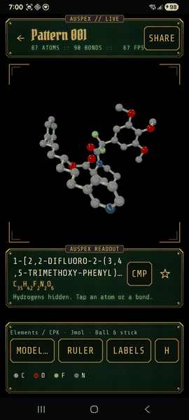

# 26 · Cambios de pantalla: encender, parpadear, cortar

> **Estado:** **escrito**. Sustituye la mitad «apagar» del tubo del documento 23. Reglas puras **probadas en la JVM** (631 pruebas en total; 14 nuevas; 25 mutantes, todos muertos al final). El cambio entre pantallas es un **parpadeo**: a negro y de vuelta bajo un resplandor verde, 180 ms (§3). Las dos versiones anteriores (estática de televisor y pulso de luz) se describen en §3.3. El dibujo del pulso, el arranque que espera al tubo y el diálogo que espera en una carga silenciosa **compilan contra *stubs*** y pasan las reglas de Compose; **sin probar en el móvil** (§8).

## Índice

1. [Qué se pidió tras verlo en el móvil](#1-qué-se-pidió-tras-verlo-en-el-móvil)
2. [Tres maneras de cambiar de pantalla](#2-tres-maneras-de-cambiar-de-pantalla)
3. [El parpadeo con resplandor](#3-el-parpadeo-con-resplandor)
4. [El encendido, solo al arrancar, y el arranque que lo espera](#4-el-encendido-solo-al-arrancar-y-el-arranque-que-lo-espera)
5. [Abrir un ligando: descargado o archivado](#5-abrir-un-ligando-descargado-o-archivado)
6. [Cómo lo hace `CrtSwitch`](#6-cómo-lo-hace-crtswitch)
7. [Pruebas y mutación](#7-pruebas-y-mutación)
8. [Cómo probarlo en el móvil](#8-cómo-probarlo-en-el-móvil)
9. [Trampas](#9-trampas)
10. [Alternativas](#10-alternativas)
11. [Decisiones](#11-decisiones)
12. [Qué recordar](#12-qué-recordar)

---

## 1. Qué se pidió tras verlo en el móvil

El tubo del documento 23 era **un solo efecto en dos mitades**: la pantalla vieja **se apagaba** (se aplastaba en una línea y en un punto) y la nueva **se encendía** (el punto se estiraba en una línea y la línea se abría). Gustó, pero no siempre encajaba:

| Situación | Antes | Lo que se pidió |
|-----------|-------|-----------------|
| Arranque en frío | Encendido sobre la pantalla de arranque | **Igual**, pero que no se coma el principio del arranque (sus líneas y sus sonidos) |
| Abrir un ligando que hay que **descargar** | Diálogo de carga **y además** el tubo | **Solo** el diálogo con el servo-cráneo y su sonido, y que dure **al menos 2 s** |
| Abrir un ligando **archivado** | Un parpadeo del diálogo y el tubo | Un efecto corto de cambio de pantalla (hoy, el **parpadeo**) |
| Atrás, ajustes, tutorial, acceso… | Apagar + encender | Un efecto **corto**, sin abrir ni cerrar desde el centro. Primero se pidió «como un televisor que cambia de canal»; después, un pulso de luz; al final, **negro primero y un resplandor verde después** (§3) |

## 2. Tres maneras de cambiar de pantalla

| Cambio | Cuándo | Efecto | Pieza pura |
|--------|--------|--------|------------|
| **Encendido** | Solo en el **arranque en frío**, sobre la pantalla de arranque | Un punto → una línea → la imagen (420 ms) | `CrtTransition` |
| **Corte** (`CUT`) | Un ligando (o el segundo de una comparación) **recién descargado** | Ninguno: el diálogo de carga ya fue la transición | `Navigation.change` |
| **Parpadeo** (`CHANNEL`) | **Todo lo demás**: un ligando archivado, Atrás, ajustes, tutorial, acceso, bloqueo y desbloqueo | A negro, intercambio, y la imagen nueva bajo un resplandor verde que se apaga (180 ms) | `ChannelChange` |

La regla es **una función pura**, probada:

```kotlin
fun change(from: Screen, to: Screen): Change = when {
    from is Screen.Index && to is Screen.Molecule && to.origin == Origin.NETWORK -> Change.CUT
    from is Screen.Molecule && to is Screen.Compare && to.secondOrigin == Origin.NETWORK -> Change.CUT
    else -> Change.CHANNEL
}
```

- **El origen decide**, y ya venía en la pantalla: `Screen.Molecule` lleva `origin` (NETWORK, ARCHIVE, ARCHIVE_OFFLINE, documento 13), y `Screen.Compare` lleva ahora el de su segunda molécula (`secondOrigin`).
- **Solo desde el índice** (o desde la molécula, para la comparación). Volver del acceso a una molécula descargada hace una hora es un **parpadeo**: esta vez no hubo diálogo antes.

## 3. El parpadeo con resplandor

```
progreso 0 ─ 0,3 ─────────────────────────────────── 1          (180 ms)
          a negro │ intercambio en el negro; el negro se levanta deprisa,
                  │ el resplandor verde sube sobre la imagen nueva y se apaga
```

1. **La pantalla vieja se apaga** a negro, en línea recta: ~55 ms.
2. **En el punto 0,3 el negro es completo** y aún no hay resplandor: no se ve **ninguna** de las dos pantallas, y se intercambian.
3. **El negro se levanta** deprisa (`u³`, con `u` de 1 a 0).
4. A la vez **sube el resplandor** del fósforo sobre la imagen nueva y se apaga (`u²·(1 − u³)`, escalado para que su pico sea 0,6). Es el **brillo residual** de un tubo que acaba de encenderse.
5. Encima, **líneas de barrido** tenues que siguen al negro y al resplandor.

**El color del resplandor:** un degradado radial de `#B4F5C2` (verde pálido, en el centro) a `#3E8F55` (verde fósforo, en los bordes), porque un tubo brilla más en el medio.

**Por qué funciona:**
- **El negro va primero.** El ojo descansa en él y no recibe un fogonazo; la luz llega **después** y nunca cubre del todo la imagen (pico 0,6).
- **El resplandor dice «tubo», no «lámpara».** Así se ve un CRT que se apaga y se enciende.

**La curva del resplandor:** `u²·(1 − u³)` vale 0 en el intercambio (todo negro: no hay nada que iluminar) y 0 al final, y tiene un único máximo. Derivando, `2u − 5u⁴ = 0`, el máximo está en `u³ = 2/5` y vale `u²·3/5 ≈ 0,326`. El código divide por ese valor para que el pico sea exactamente `GLOW_MAX` (`GLOW_SHAPE_PEAK`), y una prueba comprueba que lo es.



*El parpadeo sobre dos capturas reales del A33, ralentizado ×4 (el mismo guion de Python que sirvió para elegirlo).*

### 3.1 Un cambio en mitad de otro

Si llega otra pantalla mientras aún hay negro (dos toques rápidos), el cambio nuevo empieza **en el lado que oscurece**, con el **mismo** negro que hay en pantalla (`ChannelChange.restartAt`). La imagen **nunca vuelve** para enseñar una pantalla que ya no es la buscada.

### 3.2 Barato

Un rectángulo negro, otro con un degradado y unas líneas, solo durante 180 ms y solo en la fase de dibujo. No crea nada por fotograma.

### 3.3 Cómo se llegó: tres versiones vistas en el A33

| Versión | Qué era | Por qué no |
|---------|---------|-----------|
| 1. **Estática de televisor** (320 ms) | La imagen se ahogaba en **nieve** (una tesela de granos aleatorios movida en cada fotograma) y una barra del sincronismo vertical bajaba por la imagen nueva | Evocaba un **televisor viejo de la Tierra**, no el cogitador; y era larga |
| 2. **Pulso de luz** (160 ms) | Todo el cristal se iluminaba en verde fósforo pálido, casi blanco en el centro, y se apagaba | En una app oscura, un fogonazo: **demasiado brillante** |
| 3. **Parpadeo con resplandor** (180 ms, la que se queda) | Negro primero, después un resplandor verde que se apaga | — |

**Cómo se eligió la tercera:** se prepararon tres propuestas como **GIF sobre capturas reales** del A33, ralentizados ×4, con un guion de Python que reproduce las mismas curvas que el código:
- A, un pulso oscuro (verde apagado y bordes negros);
- B, el parpadeo negro con resplandor;
- C, un haz de barrido que borraba y redibujaba la pantalla de arriba abajo.

Se eligió **B, con el resplandor más brillante** (de 0,15 a 0,6 en el pico). De las versiones anteriores se quedan el **esquema** (el intercambio con la pantalla tapada del todo) y el **reinicio desde lo que se ve**.

## 4. El encendido, solo al arrancar, y el arranque que lo espera

**El problema.** La pantalla de arranque empezaba su reloj **en cuanto se componía**, a la vez que el tubo se encendía encima. Los 420 ms del encendido **se comían** su principio: la primera línea y su tic sonaban con la pantalla aún tapada.

**El arreglo.**
- `CrtSwitch` dice a cada pantalla **si el tubo ya está encendido** (`on`, un `derivedStateOf`: cambia una sola vez, no recompone en cada fotograma).
- `BootScreen(running = on)`: su reloj **no arranca** hasta entonces (`LaunchedEffect(running)`). Hasta ese momento se queda en el instante 0, sin ninguna línea escrita.
- El **zumbido del tubo** (`BOOT_HUM`) sigue sonando **al componerse**, es decir, **durante el encendido**. Suena justo cuando el punto se abre en la línea: el sonido y la imagen cuentan lo mismo.

Resultado: **4,2 s de arranque completos** después de los 0,42 s del encendido, con todas sus líneas y sus sonidos. El mínimo de 1 s antes de poder saltarlo cuenta también desde que el tubo está encendido.

## 5. Abrir un ligando: descargado o archivado

### 5.1 La política (`LoadingPolicy`, pura)

| | Descargado | Archivado («ARCHIVED») |
|---|-----------|-----------------------|
| ¿Diálogo de carga? | Sí, **al momento** | **No**… salvo que tarde más de **600 ms** |
| ¿Sonido del módem? | Sí | No |
| Duración mínima | **2 s** | Ninguna |
| Cambio de pantalla | **Corte** | **Parpadeo** |

- **¿Por qué 2 s?** En una red rápida el fichero llega en unos cientos de milisegundos, y el diálogo solo **parpadeaba**. El servo-cráneo que flota, las etapas que se marcan y el módem son parte de la experiencia: ahora tienen su tiempo.
- **¿Por qué un archivado va en silencio?** La copia está en el móvil y se abre en milisegundos: un diálogo solo parpadearía. Basta el parpadeo.
- **¿Y si un archivado tarda?** Una copia de más de 30 días se **refresca** en la red (documento 13), y con una red lenta eso tarda. Si la carga silenciosa pasa de **600 ms**, el diálogo aparece igualmente: nadie se queda esperando sin saber qué pasa.

### 5.2 Dónde se decide

- **El ViewModel**, al tocar: `open(id)` → `loader.load(id, quiet = id in archived.value)`, usando el mismo conjunto que pone ARCHIVED en las celdas. Igual para la segunda molécula de la comparación (`openCompare`).
- **`LoadState.Loading`** lleva ahora `quiet`. El diálogo lo lee: silencioso → espera la gracia; si no, aparece ya. Los sonidos lo leen: silencioso → sin módem. Su etiqueta de sonido es otra (`quiet:ATP`), para que una carga ruidosa posterior del mismo id sí suene.
- **`LigandLoader`** aplica el mínimo: con el resultado ya listo, **espera lo que falte** (`delay`) **dentro de la misma tarea** y en el hilo principal, y solo entonces publica. Así sigue cumpliendo su garantía (documento 06b):
  - un **Cancel** durante la espera la detiene y **no se publica nada**;
  - el progreso de las etapas sigue llegando;
  - el mínimo vale también para un **fallo**: el diálogo no parpadea antes del error.

## 6. Cómo lo hace `CrtSwitch`

```kotlin
CrtSwitch(target = screen, startOff = !booted, reduceMotion = reduce) { shown, tubeOn -> … }
```

- **Dos valores**, leídos solo en el dibujo:
  - `cover`, 1 → 0 durante el encendido;
  - `channel`, el progreso del parpadeo, o −1 si no hay ninguno.

  En reposo los dos están en «nada», la cortina no dibuja y no se pide ningún fotograma.
- **Al llegar una pantalla nueva** (otra `key`):
  - `CUT`: se cambia al momento;
  - `CHANNEL`: se avanza fotograma a fotograma, y la pantalla mostrada se cambia **el fotograma en que el negro es completo**.
- **Mientras dura**, una capa transparente absorbe los toques.
- **Animaciones del sistema desactivadas**: todo es inmediato, y el arranque empieza al momento.

## 7. Pruebas y mutación

| Fichero | Nuevas | Qué fija |
|---------|--------|----------|
| `ChannelChangeTest` | 5 | Nada al principio ni al final; **negro completo y sin resplandor en el intercambio**; oscurece hasta el intercambio (sin resplandor sobre la pantalla **vieja**) y luego el negro solo se levanta; el resplandor sube a su pico **exacto** (0,6, entre 0,5 y 0,8) y baja; un parpadeo (≤ 200 ms, intercambio antes de la mitad); un cambio en mitad de otro empieza con el mismo negro |
| `LoadingPolicyTest` | 3 | 2 s para una descarga, nada para un archivado; lo que falta nunca es negativo; la gracia entre 0,3 y 1 s |
| `LigandLoaderTest` | 5 | Una descarga instantánea sigue cargando hasta el mínimo; una silenciosa no espera; sigue silenciosa con las etapas; un Cancel durante la espera no publica nada; un fallo también espera |
| `NavigationTest` | 1 | Corte solo para lo recién descargado y solo desde el índice (o la molécula, en la comparación); parpadeo en todo lo demás, incluido volver del acceso; la comparación lleva su origen |
| `SoundTagsTest` | (ampliada) | La etiqueta de una carga silenciosa es otra |
| `CrtTransitionTest` | 1 (−2) | Solo queda el encendido: tiempo, desde la mitad, reloj hacia atrás, por debajo de 600 ms |
| `GlintTest` | (cambiada) | La primera pasada del **destello** de la cabecera espera al encendido y al parpadeo |

**Mutantes (19, muertos):**
- (primera versión) estática incompleta en el intercambio, intercambio tardío, reinicio desde cero, barra antes de tiempo, cambio largo;
- (pulso de luz) luz incompleta en el intercambio, caída en línea recta, 320 ms, reinicio desde cero, líneas de barrido a tope todo el tiempo;
- corte para lo archivado, corte desde cualquier pantalla, comparación sin origen;
- mínimo también para lo silencioso, resto negativo, sin espera, etapas que pierden el silencio, silencioso que espera;
- la misma etiqueta de sonido.

**Sin prueba automática:** el dibujo del parpadeo, el resplandor y sus líneas; que el arranque espere de verdad al tubo; el diálogo que aparece tras la gracia. Ver §8.

## 8. Cómo probarlo en el móvil

1. **Arranque en frío** (cerrar desde Recientes): punto → línea → arranque, y **después** las líneas una a una con sus tics. El zumbido suena con el encendido.
2. **Arranque → acceso**, **acceso → índice**: negro un instante, y la pantalla nueva aparece bajo un resplandor verde que se apaga.
3. Un ligando **nunca abierto**: el diálogo con el cráneo y el módem **2 s** como mínimo, y la molécula **sin** estática.
4. Un ligando **ARCHIVED**: sin diálogo, sin módem; un parpadeo y la molécula.
5. **Atrás** desde la molécula, **ajustes**, **tutorial**: parpadeo.
6. Dos toques rápidos (abrir los ajustes y volver): la pantalla vieja no vuelve a asomar.
7. **El 3D también queda tapado** por el negro en el intercambio.
8. Modo avión y un ligando nuevo: el diálogo 2 s y luego el error.
9. **IDLE** en la molécula tras el cambio.

## 9. Trampas

1. **Animar una pantalla mientras otra animación la tapa**: el arranque perdía su principio bajo el encendido.
2. **Un diálogo de carga que parpadea**: rápido no siempre es mejor; un mínimo lo hace legible.
3. **Un mínimo que rompe la cancelación**: esperar **fuera** de la tarea publicaría un resultado ya cancelado.
4. **Dos transiciones seguidas** (diálogo + tubo): demasiado.
5. **Un efecto que evoca otra cosa**: la estática decía «televisor de la Tierra», no «cogitador». La estética manda tanto como la técnica.
6. **Reiniciar un efecto desde cero** cuando se interrumpe: la pantalla equivocada asoma un instante.
7. **Ocultar un diálogo para siempre** en una carga «rápida» que resulta lenta: hace falta la gracia.

## 10. Alternativas

| Alternativa | Por qué no |
|-------------|-----------|
| Un *shader* AGSL de ruido de verdad | Solo Android 13+; la app es minSdk 24 |
| Desplazamiento horizontal de la imagen (*tearing*) | El SurfaceView del 3D no se transforma (documento 23, §2.3) |
| Parpadeo también tras una descarga | Dos transiciones seguidas |
| Diálogo también para lo archivado, con su mínimo | 2 s de espera para algo que ya está en el móvil |
| El mínimo en el diálogo (que se quede abierto aunque el estado ya sea Loaded) | La molécula aparecería **debajo** del diálogo; el estado único (`LoadState`) dejaría de decir la verdad |
| Estática de televisor (nieve y barra de sincronismo) | La primera versión (§3.3): evocaba un televisor viejo de la Tierra, no el cogitador, y era el doble de larga |
| Pulso de luz (todo verde pálido) | La segunda versión (§3.3): demasiado brillante en una app oscura |
| Haz de barrido de arriba abajo | Muy del tema, pero el movimiento vertical cansa en un «Atrás» frecuente, y dura más |
| Un sonido para el parpadeo | Ninguno de los diez sonidos encaja; uno nuevo con `make_sounds.py` es posible si se quiere |

## 11. Decisiones

| # | Decisión | Estado | Motivo |
|---|----------|--------|--------|
| D91 | **Tres cambios de pantalla**: encendido solo en el arranque en frío, **corte** tras una descarga, **parpadeo** de 180 ms en todo lo demás (a negro y de vuelta bajo un resplandor verde; la estática y el pulso de luz se descartaron); la mitad «apagar» del tubo desaparece | Decidida (sin probar en el móvil) | Probado en el móvil por el equipo; sustituye parte de D84 |
| D92 | La pantalla de arranque **espera al tubo** para empezar su reloj | Decidida (sin probar en el móvil) | El encendido se comía sus primeras líneas |
| D93 | **Carga silenciosa** de un ligando archivado (sin diálogo ni sonido, salvo que pase de 600 ms) y **mínimo de 2 s** del diálogo de una descarga, aplicado en el `LigandLoader` | Decidida | El diálogo parpadeaba; lo archivado no lo necesita |

## 12. Qué recordar

- **Cada transición tiene un sitio:** encender es empezar, parpadear es moverse, y un diálogo de carga ya es una transición.
- **El efecto tiene que hablar el idioma de la app:** la nieve era técnica correcta con la estética equivocada, y el pulso, demasiada luz para una app oscura.
- **Para elegir un efecto, enseñarlo:** tres GIF sobre capturas reales deciden más rápido que tres descripciones.
- **Una animación no debe tapar a otra:** lo de debajo espera.
- **El mínimo se aplica donde está la verdad** (el cargador), no en la pantalla.
- **Interrumpir un efecto** es continuarlo desde lo que se ve, no empezarlo de nuevo.
